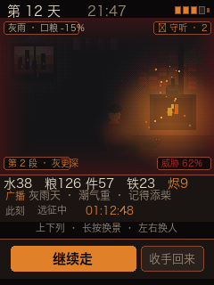
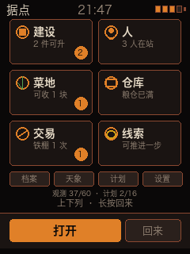
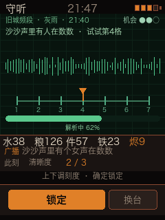

[简体中文](./UPGRADE_PLAN_20261114.zh_CN.md) · **English**

# Ember 2.0 — The Observation Era: gameplay, motion and page-design upgrade plan

Date: 2026-11-14 (Asia/Shanghai)
Baseline: `feature/ashbox-ember`, HEAD `0dfba4c` plus the uncommitted audit fixes
Status: **proposal, not a committed implementation**. All numbers are first-pass suggestions and must be calibrated with the host simulation before landing.

---

## 0. Bottom line

**One-line diagnosis:** this is already a complete, capped, offline-safe post-apocalyptic station management game, but it is not yet an *observation* game — during the waiting stretch there is nothing to watch, after returning there is no story to read, and the only things that can change on screen are a three-frame sprite and one radio line.

**One-line direction:** turn observation from a theme into a mechanic: let the station move by itself, let the world say one new thing every day, let an expedition contain two worthwhile bets, give every survivor a mood and a bond, and always leave the player one visible next thing to want.

**Five judgements (ordered by value per unit of work):**

| # | Judgement | Why | Package |
| --- | --- | --- | --- |
| 1 | Do "a screen that moves" and the return digest first | No new rules; changes first impression and the feel of every return | A, F |
| 2 | Then "phenomena + signal watch + codex" | A deterministic world layer makes observation collectable, predictable and discussable | B |
| 3 | Turn one wait into one to three legs | Same wall clock, one decision point becomes three, no second clock | C |
| 4 | Add Projects for the mid-game and a workshop intensity dial for late-game payback | Unlocks run dry after the three quest lines; workshop L3→L5 currently has negative return | E |
| 5 | People and death last, but they are what turns a game into a work | Six survivors are stat blocks today; death is one line | D |

**Recommended first cut (shippable within two weeks):** all of package A, the F information architecture, B2 phenomena, B4 night vignettes, and the return digest. It does not touch the save ABI or the v13 structure, and it establishes "every return has something new to see".

---

## 1. Current state: what the game is

### 1.1 Scale

| Dimension | Current | Source |
| --- | --- | --- |
| Platform | ESP32-C3, 160 MHz, no PSRAM, 8 MB flash, ESP-IDF 5.5.3 | `PROJECT.md` |
| Screen | 240×320, 16-bit; stage 240×176; three keys (Up/Down/OK) | `LAYOUT_LOCK.md`, `bsp_button.h` |
| UI | LVGL 9.5, 48 KB pool, software rendering | `sdkconfig.defaults` |
| Firmware | app 2,921,488 B / 8,323,072 B = **35.1%**, **64.9%** free (about 5.4 MB) | `AUDIT_CODE_20261112.md` |
| Main consumers | sprites ASR1 ≈1.26 MB, PCM 631,884 B, glyph bitmaps 106,480 B | same |
| Save | `ASH2` v13, 776 B blob, 19 static assertions, append-only | `ashbox_game.h`, `ashbox_save.h` |
| Content | 5 tiers, 61 branches, 12 tags ×5, 13 outcomes, 40 travel lines, 50 radio lines, 94 help lines, 3 quest lines ×5 beats, 15 build rows, 12 scenes ×3 frames, 6 survivors | `ashbox_content.c`, `ashbox_ui*.c` |
| Systems | food/water/parts/iron/ember, stash, farm, two-camp trade, meds, gear, visitors, duties, chores, night orders, crisis, arc re-arm, meta achievements | `ashbox_game.c` |

### 1.2 Current rhythm and numbers

| Flow | Value | Note |
| --- | --- | --- |
| Food production | +4/healthy person/hour | `apply_economy` |
| Food consumption | −1.5/present person/hour | kitchen L3 −10%, stove lining −1 step |
| Parts production | workshop L1–5: **1.0 / 1.5 / 2.0 / 2.4 / 2.8 per person/hour** | `parts_mult_num` 10/15/20/24/28 |
| Threat | base **1.5/h**; **1.05/h** after the Tin Visitor line | reaches 80 in about 53 h; workshop adds +2 rise per level |
| Water | 7.5/person/day used; pit up to 15/day, well up to 48/day (daily cap) | water is not the brake at 3 people |
| Upgrade cost | dorm/kitchen/workshop 8 / 24 / 60 / 100 / 100 parts | `k_upgrade_cost` |
| Beds | 2 / 3 / 4 / 5 / 6 | population also capped by kitchen tier and workshop ≥2 |
| Expeditions | 3 min / 1 h / 4 h / 2 h / 8 h | short/block/deep/hunt/overnight |

**Key inference:** after day one, food, parts and water all sit in overflow. **The scarce resource is not material but "the next new thing".** Workshop L3→L5 spends 60/100 parts for +0.4 parts/person/hour and raises threat every level — a negative late-game investment (audit C13 is still open). So the goal is not more difficulty; it is **more goals, more expression, and more optional risk**.

### 1.3 What it already gets right (must keep)

1. **Offline safety:** wall-clock settle, deep-sleep scaling, saturating caps, no online requirement.
2. **Rules/UI separation:** `ashbox_game.c` is host-testable; that is the foundation for every new system.
3. **Coherent theme:** embers, the box, ash tide and radio are the real moat.
4. **Honest economy:** no gacha, no paid acceleration, no wipe-to-prestige.
5. **Pixel stage:** 12 scenes at 240×176 are an asset, not wallpaper.

### 1.4 Where it is not yet fun

| # | Severity | Problem | Evidence / feel |
| --- | --- | --- | --- |
| D1 | S1 | **Observation is not a mechanic:** waiting only produces numbers; nothing on screen is worth watching | home has a 3-frame/320 ms sprite, one looping radio line, one countdown |
| D2 | S1 | **The return moment is thin:** no digest; the report only covers expeditions, station production is invisible | `report` is expedition-only; `ash_game_settle` writes no narrative |
| D3 | S1 | **No decisions during the wait:** one choice at the end of an expedition; a 30-second session has almost nothing to do | single endpoint; off-expedition only 3 duties/day and chores |
| D4 | S1 | **Mid-game goal gap:** after 3×5 quest beats only arc re-arm; late build rows have negative return | audit C13/C18; workshop L3→L5 payback 150–250 h |
| D5 | S2 | **Content is seen through quickly:** 12 fixed tag pools; the same tag means the same answers | tag pools fixed; state filtering only half-done |
| D6 | S2 | **People are stat blocks:** no mood, no bonds, no personal stories; death is one line | `ash_person_t` only state/trust/fatigue |
| D7 | S2 | **Late economy has neither pressure nor sink:** ember stacks to 999 after 17 points of outlets; parts overflow | audit C09/C13 |
| D8 | S2 | **Threat has little presence:** 1.5/h, about 53 h to 80; crisis is always the same three options | `maybe_arm_crisis`, `k_crisis_*` |
| D9 | S2 | **Pages lack hierarchy and identity:** 21 pages are mostly "list + two buttons"; hub is 15 flat rows | `UI_*`, `paint_hub` |
| D10 | S2 | **Onboarding is read, not done:** 94 flat help lines; first-run guide is a text page | `k_help_lines`, `paint_guide_overlay` |
| D11 | S3 | **Failure and death carry no weight:** a death is one report line, no rite, no memory | `remove_person_at` only logs |
| D12 | S3 | **No record of what I have seen:** 50 radio lines and 4 shards, no archive page | no codex |

---

## 2. North star

### 2.1 Player-facing sentence

> **You keep one fire and listen to the world outside the door. Every return, one thing is waiting to be seen; every departure leaves one mystery to solve.**

### 2.2 Five pillars

| Pillar | Problem it solves | Player feeling | Package |
| --- | --- | --- | --- |
| **P1 A station that breathes** | the screen is dead | "it kept living while I was away" | A |
| **P2 A world worth listening to** | observation is not gameplay | "what did the outside say today" | B |
| **P3 Expeditions with a return** | waiting has no decisions | "one more leg, or take it home" | C |
| **P4 People who feel like people** | survivors are numbers | "I do not want Xiao Mang to get hurt" | D |
| **P5 Always a next thing** | mid-game goal gap | "two more days and the radio is fixed" | E |

### 2.3 Target session shapes

| Session | Player should finish | Target | Today |
| --- | --- | --- | --- |
| **Quick look** | read one change; collect; send the next trip | 20–40 s | only a countdown/report, no digest |
| **Sit a while** | one signal watch; one station task; spend resources | 2–4 min | 3 duties/day; otherwise menu digging |
| **Play properly** | resolve a crisis; advance a project; live a character scene | 15–25 min | crisis and building only |
| **A day** | one phenomenon, one or two signals, one quest beat, one visitor, one project node | wall clock | quest beat and visitor only |
| **A week** | one project, one personal line, one arc | wall clock | arc only |

**Acceptance rule:** at any moment the home screen must offer **two available actions** and **one new piece of information**. With no expedition, no crisis and no report, "nothing to do" is a failure.

### 2.4 Non-goals (hard rails)

1. No IAP, ads, gacha, speed-up tickets, or daily-login punishment.
2. No wipe-to-prestige or seasonal reset; arc re-arm stays.
3. No "must be online to grow" resource; every new system settles offline or is capped.
4. No second clock; all new systems hang off `ash_game_settle` and existing pages.
5. Do not shrink the 240×176 stage, cut scenes/frames, or use lossy art.
6. No menu deeper than two levels; three-key reachability first.
7. Keep engineering words out of player-facing copy.

---

## 3. Package A: a station that breathes (motion layer 2.0)

> Goal: **the screen comes alive without new rules**; every effect can be switched off, power first.
> No layout-lock change: all new elements are HUD and particles over the 240×176 stage; existing geometry does not move.



### A1 Stage HUD (game-like overlay)

Four translucent chips in the stage corners, instead of squeezing every fact into the 52 px band:

| Corner | Content | Condition |
| --- | --- | --- |
| top-left | phenomenon icon + name + one impact ("ash rain, food −15%") | always |
| top-right | signal state: "watch 2" / "silent" | blinks when a window is live |
| bottom-left | expedition leg and time left | during an expedition |
| bottom-right | threat "62%", red pulse at ≥80 | threat ≥50 |

Spec: each 56–86×14 px, radius 3, `COL_SURF` at 85% opacity, 1 px `COL_LINE`; 10–11 px text. The chips must not cover the stage centre (figure/fire/door).

### A2 Time-of-day grade (one object, biggest win)

One full-stage rectangle whose colour and opacity follow the clock:

| Window | Colour | Opacity |
| --- | --- | --- |
| 05:00–07:00 dawn | `#FF9A5A` | 25% |
| 07:00–17:00 day | transparent / warm white | 0–8% |
| 17:00–20:00 dusk | `#E06028` | 30% |
| 20:00–05:00 night | `#101840` | 45% |

Phenomena override (ash rain +18% grey, fog +15% off-white). Update at most once per 60 s to avoid full-screen repaints.

### A3 Weather particles (10–18 objects)

Fixed object pool, enabled per phenomenon, 8–10 fps, only at home while `PWR_ACTIVE`:

| Effect | Objects | Implementation | Trigger |
| --- | --- | --- | --- |
| Rising embers | 10 | 3×3 dots drifting above the fire, alpha by life; **density scales with ember stock** (max 14) | always |
| Ash rain | 8 | 2×6 streaks, 2 px/frame downward, looping | ash rain |
| Fog | 3 | 240×22 bands at 12–18% opacity, drifting sideways | fog / ash rain |
| Dust | 12 | 2×2 dots drifting sideways | dust / iron wind |
| Frost/stars | 6 | 1×1 dots twinkling | frost / starfall / moonwhite |
| Fire breathing | 2 | 24/48 px circles, alpha 40–90 sine | stove lit |
| Threat vignette | 4 | four edge gradients, red; 2 s pulse at ≥50, 0.8 s at ≥80 | threat ≥50 |

Fire anchor points come from a 12-entry per-scene table (`{x, y}`), not guesswork.

### A4 Transitions and juice

| Effect | Spec | Cost |
| --- | --- | --- |
| Number bump | resource change 1.0→1.15→1.0 over 180 ms, amber; one reused floating "+N" label | 1 label |
| Bars/badges | threat and resource bars flash once on change; 2× 1 px shake on crisis | 0 |
| Key feedback | 40 ms inset + sound; long-press shows progress | 0 |
| Page transition | forward slides in from the right over 120 ms, back slides out left; modal fades/scales in 100 ms | 1 mask |
| Scene change | 240 ms crossfade would need a second frame buffer; use an 80 ms black dip instead | 0 |
| Falling asleep | backlight to zero over 600 ms, one ember dot fading on stage | 0 |

Principle: **ambience is slow (0.1–0.4 Hz), feedback is fast (<200 ms)**; no animation may delay key response or run after `PWR_DIM`.

### A5 Radio visualisation

Add six 2×8–14 px bars left of the radio label in the now band, driven by a synthetic envelope while the audio task is speaking (expose `bool ashbox_sfx_radio_speaking(void)`), flat when silent. Make "the radio is alive" visible, not only audible.

### A6 Performance budget and degradation

| Item | Budget | Degradation |
| --- | --- | --- |
| Animated objects | ≤24 steady, ≤40 transient | four settings: high/medium/low/off |
| Frame rate | 10 fps at home; 0 on list pages | medium: tint + fire only; low: tint only; off: static |
| CPU | ≤8 ms per painted frame; ≤12% total animation | auto-drop a level and log when over budget |
| Memory | no new full-frame buffer; LVGL objects only | pool 48 → 64 KB, must be measured |
| Power | everything stops after DIM; no repaint after BLANK | bind to the existing power state machine |

**Acceptance:** 10 minutes of home animation with no `lv_mem` failure; P95 frame time <8 ms; 4-hour battery drain no more than 10% above the current build.

---

## 4. Package B: a world worth listening to (observation loop)

> The identity system of 2.0: turn looking into discovery, discovery into record, record into understanding.
> All three subsystems are deterministic, offline-safe, capped, and do not punish absence.

### B1 Signal watch

**Four bands**, unlocked by progress:

| Band | Unlock | Tone |
| --- | --- | --- |
| Old City | start | the night the lights went out, kiosks, metro |
| Iron Shed | camp contact | camp voices, trade, warnings |
| Ash River | ferry contact | tide, ferry, far bank |
| Beyond the Gate | gate open | wind, ash tide, low sounds |

**Daily windows:** two per day, deterministic from `day_key` (one 19:00–01:00, one 09:00–15:00, three hours each). Listening inside a window gives a clarity bonus; a missed window can be **replayed for one day**, giving codex and story only, no mechanical bonus. No FOMO, but presence is rewarded.

**One listening session (20–40 s):**

1. Pick a band (left/right); show a strength bar and one texture hint ("someone counting in the static").
2. Tune: 7 positions (5/4/3 after clarity upgrades), up/down; each position has different noise and a hint.
3. Lock: within ±1 of the correct position decodes; three attempts per window.
4. Decode for 6 s (skippable): waveform, progress, static sound.
5. One of four results:

| Result | Content | Value |
| --- | --- | --- |
| Old news | one worldbuilding text | codex +1 |
| Landmark | tomorrow's phenomenon / a hidden cache | planning |
| Voice | a survivor's past | bond / personal line |
| Blank | only static | +1 resonance |

**Resonance:** cap 0–3, gained on failed or blank listens; before the next departure spend one for: one extra loot roll / −5 pp empty-handed / preview the next leg's risk / early return without loss. **One trip only, no stacking, no snowball.**

**Clarity:** 0–3 per band, +1 per three successful decodes; higher clarity means fewer positions and a higher result tier. This is the long-term mastery of observation and produces no combat power.

**Caps:** 2 per day (3 after the transmitter is built); resonance ≤3; no payment, no ads.

### B2 Phenomena (daily world state)

**Determinism:** a 16-day permutation so all 16 appear once per 16 days, with no repeats in a row: `phenom(day_key) = k_perm[day_key % 16]`. No save fields; a reload cannot reroll.

| Phenomenon | Effect (first pass) | Visual |
| --- | --- | --- |
| Clear | no modifier; signal clarity +1 tier | clean night |
| Ash Rain | water +50%; outdoor food −15%; fever chance +5 pp | ash particles |
| Iron Wind | parts +30%; expedition iron +1; threat +10% | horizontal wind |
| Still Night | night threat −50%; mood +2 | deep blue |
| Frost | farm growth +30%; water use −20% | frost dots |
| Long Fog | empty-handed +5 pp; shard chance +1 tier | fog bands |
| Echo Night | signal result +1 tier; one extra night window | echo ripples |
| Heat Wind | water use +30%; fever +5 pp | orange grade |
| Blackout | radio/signals off; threat +20%; visitors +1 | dark, one lamp |
| Moonwhite | night expedition loot +15%; mood +2 | moonlight |
| High Tide | one extra ferry trade; water +10 | water waves |
| Dust | parts −20%; threat −10% | dust motes |
| Dead Calm | no visitors, no signals; mood −3 | frozen frame |
| Starfall | shard +1; codex chance | star dots |
| Ash Tide Omen | threat +50%; crisis threshold −10; deep loot +20% | red fog |
| Warm Current | food +20%; mood +2 | warm grade |

**Forecast:** tomorrow is always visible (the strongest "come back tomorrow" hook); the watchtower reveals three days. Dangerous phenomena (omen, heat wind, blackout) are marked in the danger colour with one "what to do" line.

**Settlement:** `ash_game_settle` splits at local midnight, at most three segments (36 h DT cap), applying each day's phenomenon. All modifiers multiply existing flows and still saturate.

### B3 Codex

**Five volumes, 60 entries at launch:**

| Volume | Entries | Examples |
| --- | --- | --- |
| World | 12 | what the ash tide is, why the old city went dark, what is beyond the gate, where ember comes from |
| Places | 10 | short route, ruined street, deep metro, hunting ground, Iron Shed, ferry, outpost, beyond the gate |
| People | 12 | the three named survivors, three late-joiners, eight visitor types |
| Things | 14 | meds, crowbar, pistol, ammo, seeds, shards, tokens, super core |
| Events | 12 | three line endings, arcs, deaths, first gate opening, first visitor |

Each: title + 2–3 lines + one "how it was found" hint; locked entries show `???` and the hint. Unlock conditions read existing state/events and never double count.

**Observation score:** 1–3 points per entry, about 120 total; every 25% unlocks a title (Nightwatcher / Windlistener / Chronicler / Witness), displayed on the people and settings pages only, with no stats. **Pure collection, no pressure.**

### B4 Night Talk (return vignette)

On the first return of each day (or after more than 4 hours away), show a 3–4 line night scene with two choices; each gives a little mood/bond/resource/one codex line. 24 scenes at launch, filtered by state (farm, visitor, injured, bonded, high threat). **One per day, no failure, never interrupts expedition settlement.** Reuse the existing modal and choice machinery; no new page.

This is the cheapest "there is a story when I come back" implementation: players remember the night someone coughed outside the door, not the numbers.

### B5 Caps and non-goals

- 2 listens/day (3); resonance ≤3; 1 vignette/day; 1 phenomenon/day.
- The codex produces no power; titles have no stats.
- No real-time-only windows; replay means absence is not punished.

---

## 5. Package C: expeditions with a return (one to three legs)

> Same wall clock, "waiting" becomes "betting". No new clock, no tier-duration change.

### C1 Pace (a real choice before departure)

| Pace | Loot | Empty-handed | Duration | Threat |
| --- | --- | --- | --- | --- |
| Steady | ×0.85 | −20% relative | ×1.0 | none |
| Quick | ×1.0 | +10% | ×0.85 | none |
| Greedy | ×1.35 | +25% | ×1.0 | +2 on a successful return |

The departure page states the real probability in plain words ("about X% chance of coming back empty"), using the person-modified number from `ash_game_depart_fail_pct`.

### C2 Legs

| Tier | Legs | Split points | Mid choices |
| --- | --- | --- | --- |
| Short 3 min | 1 | — | none |
| Ruined street 1 h | 2 | 50% | continue / turn back |
| Deep 4 h | 3 | 40% / 75% | continue / turn back / detour |
| Hunt 2 h | 2 | 50% | continue / turn back |
| Overnight 8 h | 2 | 55% | continue / turn back |

**Rules:**

- Each completed leg accumulates loot into a carry (not banked until return).
- At a leg end while awake: a "on the way" card with 2–3 options showing risk and current carry; **nothing preselected** (same anti-mistap rule as the report page's `-1`).
- At a leg end while asleep/away: auto-continue by pace (steady = turn back, quick/greedy = continue); no offline punishment.
- Turn back: keep 60% of the carry, skip the remaining risk; ember only rolls on the final leg.
- Continue: +1 loot roll; next leg's empty-handed chance +8 pp; deep leg 3 gets an extra shard chance.
- Injury/death resolve per leg; the pistol spends ammo on an assault inside a leg.

**Feel:** a four-hour deep run is no longer "tap and leave"; the player comes back twice and makes a small decision each time. A 30-second session can resolve "leg 2 arrived".

### C3 Report 2.0

```
Someone came back
Farthest: metro exit 3
Brought: food 11 · parts 2 · iron 6 · shard 1
Cost: Ahe lightly hurt · ammo 1
[share with station] [hide the goods] [fix the fan]
```

The title changes by result: came back / empty-handed / someone did not return / only half returned. Four coloured resource chips, two narrative lines, two or three branch cards; each card shows cost and consequence preview (extend `ash_game_branch_effect` to two lines). On death, play a three-line eulogy before the branch.

### C4 Numbers and save

- New fields: `exp.leg`, `exp.leg_total`, `exp.stance`, `exp.carry_food/parts/ember/iron`, `exp.leg_waiting`, `exp.leg_choice`.
- Migration: an in-flight v13 expedition starts at `leg=0` and runs the legacy single-endpoint path; the save is never blocked.
- Tests: split points per tier, turn-back retention, auto-continue policy, recovery across deep sleep.

---

## 6. Package D: people who feel like people (mood, bonds, personal lines)

> Goal: make the player hesitate before choosing who leaves, and feel bad when someone does not come back.

### D1 Mood (0–100)

| Event | Change |
| --- | --- |
| A day with food and water | +2 |
| Sent on an expedition | −6 |
| Injured/infected | −10 |
| A bonded person dies | −15 |
| Jerky or hot meal | +8 |
| Personal line or project completed | +10 |
| Phenomenon: still night / moonwhite / warm current / gravel path | +2 |

**Band effects:** low (<30) production −10%, empty-handed +3 pp; high (≥70) production +5%, healing +20%, more likely to trigger night scenes. **No mood collapse or leaving the station** — avoid punishment.

### D2 Bonds (pair bond 0–3)

- Two people at the station, same job or same night watch: +1/day; personal line +2.
- Bond ≥2: +8% output when working the same job; bond 3: a joint scene plus a night-talk option.
- Bonds are symmetric; store the upper triangle of 6×6 (15 nibbles = 8 B).

### D3 Personal lines (6 survivors × 3 beats)

Triggers: bond/mood/specific phenomenon/specific place. Form: a 2–3 line scene plus one choice. Rewards are **unique abilities, not multipliers**:

| Person | Three beats | Completion ability |
| --- | --- | --- |
| Ahe | keeping the lamp, talking people down, an old name | crisis talk −10 extra threat (once per crisis) |
| Lao Que | taking a door apart, fixing the stove, shaky hands | fortify costs −25% parts (permanent) |
| Xiao Mang | remembering roads, fear of the dark, growing up | marks one hidden cache every two days |
| Grey Skin | came from the ash, goes into the ash, staying | night expeditions +1 iron |
| Nightwalk | keeping watch, ringing ears, dawn | +1 signal listen per day |
| Old Boot | trading, debt, coming back | visitors arrive more often (+1/week) |

### D4 Visitors 2.0

A visitor has a dossier (origin, want, offer) and three options: stay / trade / turn away. How you turn them away affects bonds and later visits; eight visitor types go into the codex "People" volume. A visitor log page can fold into the codex.

### D5 Death and memorial

- A death is no longer one line: stage dims 400 ms → three-line eulogy → everyone's mood −15 → gear returns to the stash → codex +1 (epitaph).
- The codex gains a "memorial" subsection listing everyone who left, with an epitaph generated from traits and last job.
- One funeral night scene the day after a death.

### D6 Save

`mood[6]` (6 B), `bond[15]` nibbles (8 B), `arc_step[6]` (6 B), `arc_done` (u16), `memorial_mask` (u16), `vignette_day`/`vignette_choice`. About 25 B.

---

## 7. Package E: always a next thing (goals and economy)

### E1 Projects (16, player-paced)

A project is not a quest; it is a **visible long-term goal plus a voluntary resource sink**. Materials can be contributed in batches (5 at a time) and progress is persistent; several projects can run in parallel.

| # | Project | Cost | Unlocks | Gameplay change |
| --- | --- | --- | --- | --- |
| 1 | Patch the roof | 30 parts | +1 bed | population cap |
| 2 | Fix the radio | 45 parts · 10 iron | 3-day phenomenon forecast; signal window hints | planning |
| 3 | Build the stove | 40 parts | food use −5%; hot meals affect mood | economy |
| 4 | Dig the cellar | 60 parts | stash +60; slower spoilage | storage |
| 5 | Watchtower | 50 parts · 15 iron | 1-day crisis warning | risk |
| 6 | Water tank | 55 parts | water cap +20 | water |
| 7 | Medicine cabinet | 40 parts · 2 antibiotics | healing +25%; two medicine slots | medical |
| 8 | Transmitter | 80 parts · 20 iron | invite one visitor per day | people |
| 9 | Stove upgrade | 30 iron · 4 ember | night threat −20% | night watch |
| 10 | Long lamp | 1 ember/day | no night production penalty; mood + | ember sink |
| 11 | Tool rack | 70 parts | crowbar +5; crafting −10% | tools |
| 12 | Outpost | 200 parts · 60 iron | long-range tier + a second expedition slot | endgame |
| 13 | Greenhouse | 120 parts · 3 seeds | new crop: herbs | new resource |
| 14 | Archive | 90 parts | codex hints; observation bonus | collection |
| 15 | Recast the gate | 80 iron · 6 ember | threat floor −5; new scene | endgame |
| 16 | Gravel path | 50 parts | mood +; more visitors | ambience |

**Ordering rule:** at least one of every three projects changes *how you play* (new page/action/choice), not just a multiplier. The first six cover the first eight hours, so there is a new goal every 60–90 minutes.

### E2 Late sinks (closes C09/C13)

| Sink | Cost | Return | Purpose |
| --- | --- | --- | --- |
| Lamp oil | 1 ember/day | night threat −10%, mood + | continuous ember outlet |
| Maintenance | 5 parts/day | 24 h production +10% | continuous parts outlet |
| Mods | 40 parts + 10 iron | pick one: suppressor (less threat, less loot) / scope (better hunt, slower) / reinforcement (less injury, more weight) | trade-off, not pure gain |
| Reputation donations | parts/food/water | camp reputation 3; unique trades and codex | relationships |

### E3 Fixing negative late return: workshop intensity

Today each workshop level adds +2 to threat rise; L3→L5 spends 160 parts for +0.8 parts/person/hour and accelerates threat — **upgrading is a punishment**. Change to:

- **Upgrades are pure gain:** workshop L2–5 stay at 1.5/2.0/2.4/2.8 parts/person/hour, with no threat added.
- **New intensity dial (steady/normal/hard):** output ×0.85/1.0/1.25, threat ×0.9/1.0/1.2. The player chooses output or quiet.
- Costs become 8/16/36/60, with payback about 16/32/75/125 h; the last two remain long, closed by intensity + projects + maintenance rather than more cost cuts.

### E4 Endgame: the outpost

After the outpost project, a small map opens: it stores 60 food/30 water, expeditions can start there (20% shorter), and it becomes a second expedition slot (two trips at once, each −15% loot). This is the second long-term goal after arc re-arm, and fully offline.

### E5 Achievements 5 → 16

Add: first gate opening, first camp contact, first line finished, codex 25/50/75/100%, 10 listens, 5 visitors, 1 personal line, outpost built, a clear with no deaths, a clear using only short routes, all 16 phenomena seen. Achievements grant titles and codex entries only, never stats.

---

## 8. Package F: page design 2.0

### F1 Information architecture: 15 flat rows → 6 cards + 4 entries

| Today (15 rows in the hub) | 2.0 (two columns of six cards + four entries) |
| --- | --- |
| duty / farm / resources / stash / people / gear / trade / night order / quests / achievements / journal / settings / help / build | **Build · People · Farm · Stash · Trade · Quests**; small entries: **Codex · Phenomena · Projects · Settings** |

Each card shows one status subline and one badge (2 upgrades / 1 harvest / stash full / can advance). Card = icon + 16 px title + 10 px subline + badge; 2×3 grid, card 104×56, gap 8.

### F2 Design system

| Item | Spec |
| --- | --- |
| Grid | 4 px; margin 12; content width 216 |
| Type | titles 16; body 16; sublines 12; badges/overlays 10 (add a 12 px font subset) |
| Colour | existing `COL_*` unchanged; add danger surface `#2A1010`, codex surface `#121A18` |
| Cards | radius 5; 1 px border; selected: 3 px amber left stripe + `COL_SEL` fill + 2 px outer ring |
| Focus | never colour-only: selected row also gets a `▶` and the left stripe; colour-blind safe |
| Scroll | 4 px right track + thumb; position `3/15` beside the title |
| Empty state | one plain sentence plus the next unlock condition; never blank |
| Icons | twelve 12×12 mono pixel icons (about 1.7 KB), reused across pages |

### F3 Wireframes (key pages)

**Home** (geometry unchanged):

```
[ Day 12              21:47      battery ]
[ [ash rain -15%]              [watch 2] ] 176 stage
[                fire / figure          ]
[ [leg 2 - deeper]            [threat 62%]]
[ water38 food126 parts57 iron23 ember9  ] 52 band
[ radio ||| ash rain - damp - add wood   ]
[ now  expedition - leg 2   01:12:48     ]
[ up/down list - long press scenery      ]
   [ keep going ]        [ turn back ]
```

**Hub:** 2×3 cards + 4 entries + one line "codex 37/60 · projects 2/16".



**Signal watch:** full-screen tuner; the dial and waveform take the stage area, the resource band stays below.



**Build:** four tabs (housing / production / defence / water-works), left/right to switch, up/down in the list; rows 36 px with a cost chip on the right.

**People:** list rows = name + state chip + mood face + job; detail = three mini-tabs (status / bonds / story).

**Codex:** volumes (5 + completion) → entries (unlocked/locked) → reader (2–3 lines + source).

**Phenomena:** a big card for today plus three cells for tomorrow and the day after; each with one "what to do" line.

**Signal watch:** full-screen tuner: dial, waveform, hint, attempts.

**Report / crisis:** full screen, nothing preselected, cost and consequence preview; crisis uses a red vignette and a 0.8 s pulse.

### F4 Three-key reachability rules

1. Home to any function ≤2 levels.
2. Left/right = page/card/option; up/down = list; OK = act; long-press OK = back/sleep.
3. Every page must have a visible exit (bar or hint); no "long-press only".
4. Destructive actions (super core, wipe, import) need a second confirmation defaulting to cancel.
5. No list defaults to the first row (prevents repeated-press mistakes); keep the report page's `-1` convention.

### F5 Copy constraints

- 240 px wide at 16 px Chinese gives **≤15 characters per line**; card sublines are written to 12.
- All new copy is written plainly first, then compressed to 12 characters; gate with `ash_copy_utf8` and `check_ashbox_copy_layout.py`.
- New Chinese glyphs must be added to `main/ashbox_font_symbols.txt` and both the 12 px and 16 px subsets regenerated.

---

## 9. Onboarding and rhythm

### 9.1 First ten minutes (six beats)

| Beat | Player action | Teaching | Target |
| --- | --- | --- | --- |
| 1 | Press OK to light the fire | one highlighted stage chip | reaction within 10 s |
| 2 | Upgrade the dorm to L2 | the bar offers "upgrade"; 10 starting parts cover the 8 cost | **first upgrade <60 s** |
| 3 | Send Ahe on the short route | route page shows one tier, subline says "3 minutes" | depart within 30 s |
| 4 | Choose a branch on return | read the result first, nothing preselected | understand cost |
| 5 | Receive the first night scene | two choices, both with small feedback | understand people |
| 6 | Hear the first signal | guided single tune step | understand observation |

The existing 94 help lines remain but become **six sections of three lines**, opened on demand; they are no longer the first-run tutorial.

### 9.2 Return digest

After more than 30 minutes away, show a one-screen digest (skippable):

```
You were away 7 h 12 min
Produced: food +34 · parts +12 · water +26
Happened: ash rain (water +50%) · Xiao Mang is low · stash full
Waiting: 1 report · 1 signal window · project "fix the radio" can take parts
```

Three lines, four numbers, one button. This is the most important page in an idle game and the cheapest to build.

### 9.3 Notifications and badges

- Keep one header badge, colour-coded by class: report (amber) / crisis (red) / harvest (green) / observation (cyan).
- Hub card badges mirror the header; one event is never counted twice.
- On wake, if the digest contains crisis/death/project completion, wake the display before playing the sound.

---

## 10. Engineering

### 10.1 New modules (rules/UI stay separate)

| Module | Responsibility | Dependency |
| --- | --- | --- |
| `ashbox_phenom.c/h` | phenomenon table, deterministic day lookup, modifiers, forecast | pure, host-testable |
| `ashbox_signal.c/h` | bands, windows, dial, clarity, results, resonance | pure + RNG |
| `ashbox_codex.c/h` | entries, unlock rules, score, titles | pure |
| `ashbox_project.c/h` | project table, contribution progress, unlock side effects | pure |
| `ashbox_social.c/h` | mood, bonds, personal lines, night scenes, visitor dossiers | pure |
| `ashbox_exped.c` (or inside game.c) | legs, pace, carry, leg-end choices | reuses exp |
| `ashbox_stage.c/h` | stage overlays, grading, particles, degradation | LVGL |
| UI units | `ashbox_ui_stage/codex/forecast/projects/signal/social/digest.c` | paint only |

### 10.2 Save v14 (only after M4)

| Field | Type | Bytes |
| --- | --- | --- |
| `exp.leg` / `leg_total` / `stance` | u8×3 | 3 |
| `exp.carry_food/parts/ember/iron` | u16×4 | 8 |
| `exp.leg_waiting` / `leg_choice` | u8×2 | 2 |
| `mood[6]` | u8×6 | 6 |
| `bond[15]` | nibble×15 | 8 |
| `arc_step[6]` / `arc_done` | u8×6 + u16 | 8 |
| `watch_clarity[4]` | nibble×4 | 2 |
| `resonance` / `scan_count` / `scan_day` | u8/u8/u16 | 4 |
| `phenom_seen` | u16 | 2 |
| `codex_mask` | u64 | 8 |
| `project_progress[16]` / `project_done` | u16×16 + u32 | 36 |
| `vignette_day` / `vignette_choice` / `memorial_mask` | u16/u8/u16 | 5 |
| `lamp_fuel` / `intensity` / `mods` | u8×3 | 3 |
| alignment pad | — | 2–6 |

About **100 B**; blob 776 → about 880 B. Migration: v13→v14 defaults to zero, `phenom_seen=0`, `intensity=normal`, `project_progress=0`; in-flight expeditions finish on the legacy path. Add a frozen v14 fixture and static assertions; keep the v13 fixture.

**M1/M2 do not change the ABI:** motion, digest and phenomena (pure functions, no save state) and vignettes (can use free day-latch bits) leave the struct untouched.

### 10.3 Flash / RAM / performance budget

| Item | Estimate | Headroom |
| --- | --- | --- |
| New text (16 phenomena + 60 codex + 16 projects + 48 signals + 24 vignettes + 18 personal scenes + 27 branches + 40 radio + 46 help) | ≈80–120 KB | 5.4 MB free, ample |
| Fonts (new 12 px subset + new glyphs) | ≈60–90 KB | ample |
| Twelve icons | ≈2 KB | ample |
| LVGL objects | +24 steady overlays; new pages reuse row objects | pool 48 → 64 KB must be measured |
| RAM | no new full-frame buffer; particle positions in static arrays | bss 147 KB today, room to spare |
| CPU | animation P95 <8 ms/frame; 10 fps at home | must measure on device |

### 10.4 Test matrix

| Layer | Content |
| --- | --- |
| Host tests | phenomenon determinism/modifiers, midnight split settle, signal windows/caps/clarity, codex unlocks, project progress, mood/bond math, leg settlement, v13→v14 migration, cap saturation |
| Simulation | extend `tools/sim_ashbox_roles.c`: 72-hour scripted policy; assert first-upgrade time, unlock spacing, no deadlock, no overflow |
| Gates | `./tools/validate.sh --static`, `--firmware`, glyphs, copy layout, glossary |
| Device | screen walk-through (home/hub/build/codex/phenomena/signal/report/crisis), 10-minute animation memory, 4-hour battery, deep-sleep wake digest |

**Balance assertions:**

- First upgrade ≤60 s.
- In the first 8 hours, every 90-minute window contains at least one new unlock/goal.
- With 3 people and no expedition, at least two actions are always available.
- Workshop L2–5 payback never worsens (intensity "normal").
- All 16 phenomena appear once per 16 days.
- Codex 100% takes 20–30 hours and does not depend on extreme luck.

### 10.5 Risks

| Risk | Probability | Impact | Mitigation |
| --- | --- | --- | --- |
| Scope too large | high | unfinished | six milestones, each shippable; M1/M2 do not change the ABI |
| Deeper three-key menus | medium | hard to use | ≤2 levels; visible exits; device walk-through before adding pages |
| Save migration regression | medium | corrupted saves | frozen fixtures + migration tests + preserve-save flashing |
| LVGL memory/performance | medium | stutter/crash | object pools, degradation levels, `lv_mem_monitor` logging gate |
| Phenomenon balance | medium | some days too strong | multiply existing flows only, capped, asserted by simulation |
| Copy overflow | high | truncation | 12-character subline rule + existing gates + glyph check |
| Art dependency | medium | new scenes blocked | phase 2 is fully procedural; no new sprite needed |

---

## 11. Roadmap

| Milestone | Scope | Output | Estimate |
| --- | --- | --- | --- |
| **M1 Alive** | A1–A5 + return digest + number bumps | first impression changes; no ABI change | 3–4 person-days |
| **M2 World** | B2 phenomena + forecast + day/night + weather + F1/F2 IA + hub/build pages | "every day is different"; no ABI change | 5–7 person-days |
| **M3 Observe** | B1 signals + B3 codex (first 30) + B4 night scenes + 3 achievements + onboarding | identity system; first v14 bump | 7–10 person-days |
| **M4 Bet** | C legs + pace + E1 first six projects + E3 intensity | decision density doubles | 8–12 person-days |
| **M5 People** | D mood/bonds/personal lines/visitors 2.0/death memorial | emotional weight | 8–12 person-days |
| **M6 Endgame** | E1 remaining ten projects + E2 sinks + E4 outpost + balance/device | long-term goals | 5–8 person-days |

**Start with M1+M2:** no save changes, no new art, and they immediately test whether "motion + digest + phenomena" actually make every return more interesting. M3 is identity, M4 depth, M5 the feeling of a work, M6 the long tail.

---

## 12. Acceptance metrics

| Metric | Target |
| --- | --- |
| First upgrade | ≤60 s |
| Visible change per return | ≥1 (digest/phenomenon/report/project/night scene) |
| Meaningful actions in a 30-second session | ≥2 |
| Unlock spacing in the first 8 hours | ≤90 min |
| No "nothing to do" state | with 3 people, no expedition, no crisis: ≥2 actions |
| Codex completion | 20–30 h |
| 16-phenomenon coverage | each once per 16 days |
| Workshop payback | not worsening L2–5 |
| Animation memory | 10 min with no `lv_mem` failure |
| Battery | 4 h within +10% of current build |

---

## 13. References

**This repository:**

- [Gameplay audit (2026-11-08)](./AUDIT_GAMEPLAY_20261108.md) · [Code audit (2026-11-12)](./AUDIT_CODE_20261112.md)
- [Extension design](./EXTENSION.md) · [Content fill](./CONTENT_FILL.md) · [Flash plan](./FLASH_SIZE_PLAN.md) · [Layout lock](./LAYOUT_LOCK.md)

**External (design reference only):**

- [Incremental / Idle — Design Codex](https://hayao.dev/docs/codex/genre-incremental): no unlock deserts, flat payback, a new mechanic per layer, never punish idling.
- [A Dark Room's journey](https://www.gamedeveloper.com/design/-i-a-dark-room-i-s-unique-journey-from-the-web-to-ios): minimal text plus layered reveal; looking is the rhythm.
- [How Reigns builds a variable story system](https://www.gameres.com/751834.html): filter the card pool by state instead of adding fixed answers.
- [Kittens Game metagaming study](https://press.etc.cmu.edu/file/download/2466/b7342d8f-5c31-489f-b697-42e5370df76c): the value of bottleneck phases.
- [Melvor Idle review](https://steamcommunity.com/id/xxadonisxx/recommended/1267910): menu-driven, interlocking long-term systems.
- [TapTap design log on rule mutation](https://www.taptap.cn/moment/856336892566702132): rules that bite each other create emergence; content = rules × combinations.

---

## Appendix A: what this plan deliberately does not do

- No real-time combat or reflex gameplay.
- No online, leaderboards, or social pressure.
- No second currency, gacha, or stamina.
- No wipe-to-prestige or seasonal reset.
- No replacement of the twelve scenes; all new visuals are procedural overlays.
- No extra menu levels for "more content"; rather drop a system than add a page layer.

## Appendix B: decisions needed

1. **Allow a 12 px font subset?** (largest visual-hierarchy gain; about 60–90 KB flash).
2. **Accept save v14 from M3?** If not, the codex and mood/bond must use free pad bytes and the scope must be halved.
3. **Allow new scene sprites** (outpost/memorial)? If not, express them with the existing NIGHT/GATE scenes plus overlays.
4. **Does M1 go straight to main, or ship first as an experiment branch for player feedback?**

---

## Appendix C: implementation status

### M1 "living screen + return digest" — implemented in the working tree (2026-11-14; not committed, not flashed)

**What shipped**

- **Stage overlay** (`main/ashbox_stage.c`): day-phase tint (dawn/day/dusk/night) composited over the sprite, hearth breathing glow, ember particles (6/10/14 by stock, rising from the stove), threat vignette (from threat 50, deeper at 80), and four corner chips (phase, threat, expedition/ready/duty/stash, report/crisis/wanderer). Overlays only — the twelve sprites and the layout are untouched.
- **Now band**: six radio bars that jump while the radio speaks and flatten when silent; a 350 ms gold bounce on water/food/parts/ember changes; pressed states on both buttons.
- **Return digest**: before deep sleep the game writes a **32 B** snapshot of water/food/parts/iron/ember/threat/pop to a separate NVS key `away` (**save `ASH2` v13 ABI unchanged**). On deep-sleep wake it diffs that snapshot and shows the away time, signed net changes, and pending items (report/crisis/wanderer/harvest/stash full/duty); any key dismisses it. Hidden below 30 minutes or above 3 days away; a non-deep-sleep boot discards the blob so a power-cycle cannot masquerade as the last wait.
- **New test**: `tests/test_ashbox_m1.c` covers the four day phases, threat vignette, ember tiers, snapshot validity (30 min–3 days, bad magic/version/length/epoch), and signed net changes.

**Budget**

- App 2,930,128 B (0x2CB5D0), +8,640 B (+8.4 KB) over the audit baseline; 65% of the partition free; LVGL pool raised 48→64 KB (+16 KB DRAM).
- No new sprites or fonts; about 41 new LVGL objects (14 embers + 2 glows + 2 mask/vignette + 4 chips + 4 labels + 6 radio bars + 9 digest objects).
- No save-structure change, no rules change, no new page level.

**Gates**

- `./tools/validate.sh --static`: PASS (glyph inventory, copy layout, ashbox host tests).
- `./tools/validate.sh --firmware`: PASS (ESP-IDF 5.5.3, merged image verified).
- **Device (after the M1 hotfix)**: booted on the local unit from its `0x20000` app partition (its partition table differs from the repo `partitions.csv` at `0x10000`); the save survived (food=20/day=3). The first 48 KB LVGL pool ran out of draw buffers on the depart → pick page, leaving `taskLVGL` spinning until the WDT fired while audio kept playing. Raising the pool to **64 KB** and removing the continuous scroll on the radio row and list sublabels made the pick page usable again on device. The now band is 56 px high with 18 px rows, so the radio, now, and pending-choice rows no longer collide; boot reports `lv_free=23,480` (62%).
- List sublabels and the radio row now use DOTS truncation (no scroll); the bottom hint keeps `SCROLL_CIRCULAR`. The stage is 172 px (was 176) to pay for the taller band.
- **Not verified**: the 30-minute cross-night digest path, deep-sleep wake/key race, low battery, and a full page walk-through.

### M2 "weather + information architecture" — implemented and flashed (2026-11-14; not committed)

**Weather (16 phenomena)**

- New module `main/ashbox_phenom.[ch]`: sixteen fixed phenomena (Clear, Ash Rain, Iron Wind, Still Night, First Snow, Long Fog, Echo, Heat Wind, Blackout, Moon White, Tide Rise, Sand Wind, Voiceless, Star Fall, Ash Tide, Warm Current), each with flat water/food/parts/threat deltas and one line of advice; a 16-entry day order keeps consecutive days different and repeats every 16 days.
- Settlement: `ash_game_apply_phenom_day()` runs only when a local midnight is crossed, at most three crossings per settle (`DT_MAX_S` 36 h), so short sleeps cannot farm the effect. The `ASH2` v13 save ABI is unchanged.
- Tests: `tests/test_ashbox_phenom.c` covers the 16-day permutation, determinism, no adjacent/boundary repeat, lookup bounds, and modifier ranges; `tests/test_ashbox_game.c` adds clamped-modifier cases.

**Information architecture**

- The hub list gains a **Matters** entry (`HUB_COUNT` 14→15) that collects four rows on one page: **Expedition** (ready / en route / awaiting choice / crisis), **Report** (new / none), **Night** (current order plus its result line), and **Weather** (today, its deltas, and tomorrow).
- Two pages, `UI_PLAN` and `UI_PHENOM`, reuse the shared 216×42 two-line list rows; no new object types. OK enters, long-press backs out one level, and the nav/OK/long-press tables include both pages.
- The home stage's top-left chip now shows the day's two-character phenomenon name, red on danger days; the day phase is carried by the chip tint instead of the text.
- UI wording avoids glyphs outside the font subset: the pages are labelled with existing characters rather than the proposal's original terms.

**Font fix (device tofu)**

- The weather table used characters that were listed in `main/ashbox_font_symbols.txt` but had never been regenerated into `assets/fonts/ashbox_font_16.c`, so the device drew placeholder boxes. The font was regenerated with `lv_font_conv` (Noto Sans SC 16 px, 4 bpp, no compression): 865→872 glyphs (+5,961 B), line height 18 and baseline 4 unchanged.
- `tools/check_ashbox_font_glyphs.py` now also scans `ashbox_phenom.c`, `ashbox_stage.c`, `ashbox_ambience.c`, `ashbox_digest*.c`, `ashbox_meta.c`, and `ashbox_embackup_proto.c`, so a listed-but-unbuilt glyph fails the gate instead of reaching the screen.

**Budget and gates**

- App 2,935,728 B (0x2CCBB0), +5,600 B over M1; 65% of the partition free. Boot reports `lv_free=23,492` (62%), well away from the 48 KB pool's failure point.
- `./tools/validate.sh --static`: PASS (glyph inventory, copy layout, 18 host test groups).
- `./tools/validate.sh --firmware`: PASS (ESP-IDF 5.5.3).
- **Device**: flashed at `0x20000` with the save preserved (food=28/day=3); the home weather chip, the hub Matters entry, all four plan rows, and the three weather rows work. The first build's placeholder boxes disappeared after the font regeneration (user confirmed the text is clean).

**Not verified**

- Real-device midnight deltas are still unmeasured; a host simulation (`test_phenom_midnight_once`) now confirms one application per crossing, none early, and none twice in the same day.
- The 30-minute cross-night return digest, deep-sleep wake, low battery, and a complete page walk-through.

### M3a "observation log" — implemented and flashed (2026-11-14; not committed)

**v14 save**

- Eight bytes appended to `ash_game_t`: `codex_seen` (20-bit map), `codex_flags`, `codex_points`, and `pad_v14`; 776→**784 B**, `ASHBOX_SAVE_VER` 13→14.
- A v13 blob migrates automatically: its 776-byte CRC is checked, the 772-byte prefix is copied, the new fields default to zero, and one "observation log enabled" journal line is added. After flashing, the device loaded the old save normally (food=28/day=3 preserved); the migration path is covered by host tests.
- `ash_game_crc` and the store seal clear `pad_v14`; the older v12-and-earlier migration chain is unchanged.

**Observation log**

- New module `main/ashbox_codex.[ch]`: five volumes (World, Places, People, Things, Events) × four entries = **20 entries**, each with a title, a two-to-three-line body, and a source line.
- Every unlock is derived from persistent state (first and third expedition, iron shed and ferry contact, gate, lore twist, population 1–4, crowbar/pistol/shard/super core, quest resolution, clear), and the bitmap is idempotent. Opening the log sweeps conditions so older saves fill in.
- Ranks at 5/10/15/20 entries: Nightwatch, Listener, Recorder, Witness; no stat effects.
- UI: the hub's 16th entry "Observations" opens five volume counters, then a four-entry list (`???` + "not yet recorded" when locked), then a reading page (title, body, source in a 216×200 wrapped label). All reuse the shared list rows, adding no new object types.
- The font gained 49 more glyphs (including the weather characters and entry prose) for 919 total; the glyph checker now includes `ashbox_codex.c`.

**Tests and gates**

- `tests/test_ashbox_codex.c`: table shape, initial unlocks, full-condition sweep=20, idempotence, bounds, rank thresholds.
- `tests/test_ashbox_save.c`: a v13→v14 migration case (CRC, resource preservation, new fields zeroed).
- `./tools/validate.sh --static`: PASS (glyph inventory, copy layout, host tests).
- `./tools/validate.sh --firmware`: PASS.
- **Device**: flashed 0x2CFC60 (2,948,192 B, +12,464 B over M2); boot reports `lv_free=23,492`; the five volumes, the unlocked Ash Tide and A-He entries, the locked placeholders, and the reading page all work (user: "clean, readable, and backs out correctly").

**Not verified**

- The rest of M3 (signal listening, night talks, three achievements, onboarding) is not implemented yet.
- Real-device midnight resource deltas are still unmeasured (host simulation passes).
- The v14 migration covers v13→v14 on device and older versions in host tests; other legacy blobs were not walked individually.

### M3b night talks and observation achievements — implemented and flashed (2026-11-14; not committed)

**Night talks (B4)**

- New module `main/ashbox_talk.[ch]`: 12 short scenes (campfire, garden, dressing a wound, the door, dragging metal, sleep talk, half a ration, catching rain, a still night, the radio, the hot core, an empty chair), each with three body lines and two choices.
- Scenes are filtered by camp state (crops, injured, visitor, threat ≥ 50, population ≥ 2, food ≤ 3, ash rain/still night, radio quest, super core, cleared) and the day key selects one of the eligible scenes; one per day.
- Choices only adjust water/food/parts/ember/threat/fatigue/trust, all clamped; combat values are untouched.
- The entry is the fifth row of Matters, "Night talk"; choosing or long-press skipping both set `codex_flags = day_key`, so it disappears until the next day.
- Plan rows tightened from 46 to 44 px with a 4 px top offset so five rows still fit the 228 px list layer; navigation now cycles five entries.

**Three observation achievements**

- The meta bitmap grows to eight bits: `Night speaker` (one night talk), `Listener` (five log entries), `Recorder` (ten log entries); names, conditions, and title grants are filled in, and the achievement page scrolls eight entries.
- The talk path and the log page unlock them; new bits are deferred through `s_meta_dirty` and stored after the LVGL unlock (no NVS write inside the lock).
- The hub achievement counter now uses `ASH_ACH_COUNT`, so it reads `0/8`.

**Tests and gates**

- `tests/test_ashbox_talk.c`: daily availability/mark, deterministic scene pick, clamped resources, invalid choice ignored; the host suite is now **26 groups**.
- `./tools/validate.sh --static`: PASS.
- **Device**: app 0x2D20A0 (2,957,472 B); the night-talk row is selectable, choices apply, and navigation returns correctly (user confirmed); the achievement page shows eight entries and the hub reads 0/8 (user confirmed).

**Still missing**

- B1 signal listening (windows, bands, tuning, clarity, resonance) is not implemented; the log is still 20 entries, not 30.
- Real-device midnight resource deltas remain unmeasured.

### M3c signal listening and a 30-entry log — implemented and flashed (2026-11-14; not committed)

**v15 save**

- Eight more bytes at the v14 tail: `talk_day`, `sig_day`, `sig_bits` (four 2-bit clarity values, 2-bit resonance, 2-bit daily listens, 2-bit progress), and `pad_v15`; 784→**792 B**, `ASHBOX_SAVE_VER` 14→15.
- A v14 blob migrates automatically: check its 784-byte CRC, copy the 780-byte prefix, carry the old `codex_flags` into `talk_day` (preserving "talked tonight"), zero the radio fields; the v13/v12 chain is unchanged.
- `ash_game_crc` and the store seal clear `pad_v15`. On device the old save loaded with food 28→20 because it exceeded the cap and was clamped; population and day were preserved.

**Signal listening (B1)**

- New module `main/ashbox_radio.[ch]`: four bands (Near 87.6, Old City 102.3, Far Wave 144.8, Ash Band 156.0), two listens per day, seven tuning notches per listen.
- Each notch shows signal strength as `#` marks (four at the target, decreasing away from it); `day_key + band` picks the target deterministically.
- Two windows, 19:00–01:00 and 09:00–15:00; **only in-window successes advance clarity**, one point per three successes (max 3). Listening outside a window still works but returns static and no clarity — which let the 17:00 device session exercise the whole UI.
- Four results: old news (journal), landmark (parts +1), voice (trust +1), blank (resonance +1, threat −1); resonance 0–3.
- UI: the sixth Matters row "Listen N left / outside window" opens four bands, then seven notches, then a 190 px result panel (long body lines wrap and no longer hide the effect line). `PLAN_ROWS=6` now drives both painting and navigation.

**A 30-entry log**

- Five volumes × six entries = 30; new entries are Ash Wall, Old Map, Water Tower, Tunnel, Ticket Stub, Radio, Shard Knife, Battery, First Listen, First Night Talk.
- The entry list uses six 36 px rows starting at y=4, all inside the 228 px layer; the reading page is unchanged.
- Rank thresholds stay 5/10/15/20, so a full 30 still reads "Witness".

**Tests and gates**

- New `tests/test_ashbox_radio.c`: windows, daily reset, target/signal, listen cap, clarity progress, clamped results.
- `tests/test_ashbox_save.c`: a v14→v15 migration case; `tests/test_ashbox_codex.c` now covers 30 entries and six per volume. All host tests pass.
- `./tools/validate.sh --static`: PASS.
- `./tools/validate.sh --firmware`: PASS, app 0x2D4B80 (2,968,448 B).
- **Device**: four bands, seven notches, result and back navigation work; outside a window only static appears and clarity does not move; all six rows per volume are visible and readable; "resonance +1" is no longer clipped (user confirmed).

**Not verified**

- The in-window success path on device (the session ran at 17:00, outside both windows; host tests cover the logic).
- Real-device midnight resource deltas.
- The achievement toasts (Night speaker / Listener / Recorder) have not fired on device.

### M4a departure stance and pure-gain workshop — implemented and flashed (2026-11-14; not committed)

**C1 stance**

- The departure flow gains a "stance" step with three choices: Steady (loot 85%, empty-handed ×0.8), Fast (loot 100%, empty-handed ×1.1, duration ×0.85), and Greedy (loot 135%, empty-handed ×1.25, +2 threat on a successful return).
- The stance is stored in the already-present `exp.loadout` byte (the retired loadout field), so the **v15 ABI does not change**; on completion the haul is scaled and Greedy adds threat.
- The fail-chance row shows the real post-stance number. The legacy `ash_game_start_expedition`/`_ex` entry points still use `ASH_STANCE_NONE` (no modifiers), preserving old tests and behavior.
- The departure journal reads `A-He departs Ruined Street · Steady · food…`.

**E3 pure-gain workshop (first half)**

- `workshop_threat_num` no longer adds `(lv-1)*2`: workshop levels 2–5 raise output without raising threat; the quiet wheel/door-bolt dampers and floors are unchanged.
- The strength modes (steady/normal/hard) and the 8/16/36/60 costs were completed in M4b below.

**Tests and gates**

- `test_stance_preview_and_start`: three fail-chance orderings, Fast duration 85%, `exp.loadout` write, and the legacy entry point staying unmodified.
- All existing loot/preview tests still pass; host tests PASS, static gate PASS.
- `./tools/validate.sh --firmware`: PASS, app 0x2D52A0 (2,970,272 B).
- **Device**: an in-window listen shows "clarity progress 1/3", the next shows "2/3", and the band page reads "2/2"; the stance page shows three rows with chances and departs correctly (user confirmed).

**Not verified**

- Clarity 0→1 still needs one more in-window success (currently 2/3, next window/day).
- The three loot multipliers' exact device numbers (host tests cover chance and duration; the multiplier is code-reviewed).
- The threat curve after workshop upgrades in actual play.

### M4b workshop strength modes and v16 — implemented and flashed (2026-11-14; not committed)

**Save v16 (800 B)**

- A new `build_mode` byte at 788 plus `pad_v16[7]`; `crc` moves to 796. `ASHBOX_SAVE_VER 16`, `ASHBOX_SAVE_BLOB_SIZE 800`.
- v15→v16 migration validates the old CRC at 788, copies the 788-byte prefix, defaults `build_mode` to `ASH_BUILD_NORMAL` (0), zeroes the pads, and logs "workshop strength mode enabled". v14 and older follow the existing ladder and also default to zero (normal).
- Rescue scanning adds `ver==15 → 792`; seal/decode/CRC all zero `pad_v16`; an invalid mode clamps to normal on load.

**Strength modes (E3, second half)**

- `ASH_BUILD_NORMAL=0 / STEADY=1 / HARD=2`; zero is the default, so old saves need no extra assignment.
- Output: steady 85% / normal 100% / hard 125%; threat rise: steady ×0.9 / normal ×1.0 / hard ×1.2 (after the quiet wheel/door bolt, before the floor).
- The workshop ladder is now independent: 8 / 16 / 36 / 60 (1→2…4→5), no longer sharing dorm/kitchen's 8/24/60/100/100.
- The build page gains a 16th row, "workshop mode  normal  output100 threat100"; OK cycles normal→steady→hard→normal, logs the change, and marks the save dirty.

**Tests and gates**

- `test_v15_migrates_to_v16`: v15 CRC, preserved talk/radio fields, `build_mode` normal, pads zeroed.
- `test_upgrade_cost_api` extended: four workshop prices and a zero at max level; mode cycle normal→steady→hard→normal and its names.
- Static gate PASS; firmware gate PASS, app 0x2D5680 (2,971,264 B).
- **Device**: a v15 save loads with `size=800` and keeps food/pop/day; the build page shows "workshop mode", normal/steady/hard cycles, and the last mode survives leaving the page and a reboot (user confirmed).

**Not verified**

- Per-level workshop price display on the device (host covers the API; the device never reached level 3+).
- Actual parts output and threat slope over a long steady/hard run.
- Clarity 0→1 still needs one more in-window success (progress 2/3).

### M4c leg expeditions and the first six plans — implemented and flashed (2026-11-14; not committed)

**Save v17 (816 B)**

- New tail fields: `exp_leg`, `exp_leg_total`, `exp_leg_waiting`, `exp_leg_extra_fail`, `plan_done`, `plan_parts[6]`, `pad_v17[5]`; `crc` moves to 812.
- v16→v17 validates the old CRC at 796, copies the 796-byte prefix, defaults the new fields to zero, and logs "leg expeditions and plans enabled"; v15 and older follow the existing ladder.
- Rescue scanning adds `ver==16 → 800`; seal/decode/CRC zero `pad_v17`.

**C2 leg expeditions (first version)**

- Two legs: Ruined Street / Hunting Grounds / overnight; three: Deep; Short still has one leg. `exp_leg_total` stores the count.
- Reaching a boundary while awake freezes the trip there (`exp_leg_waiting=1`); the quests→expedition row says "en route", home shows "远征停住", and the "en route" page offers Continue / Withdraw.
- Continue clears the wait and adds `exp_leg_extra_fail += 8` (cap 40) to the final empty-handed chance.
- Withdraw banks `completed legs × 60%` of the trip's loot and resolves the return immediately; the person comes back and a report appears.
- Offline or long gaps (deep sleep, or one settle of ≥15 minutes) auto-continue, so being away never leaves the trip stuck at a boundary.
- **First-version limits**: no per-leg carried inventory; withdraw scales the final haul instead. No in-leg encounters or per-leg pistol use. Those are C2.1.

**E1 first six plans**

- The build page gains "plans 0/6" with: roof 30 parts, radio 45 parts + 10 iron, stove 40, cellar 60, watchtower 50 + 15 iron, water tank 55.
- Each OK contributes 5 parts (or the remainder); a plan completes only when parts are full and iron is paid. Full parts with short iron stops at "parts full, iron short" and completes on the next OK once iron arrives.
- Effects: +1 bed; the third "day after tomorrow" forecast is locked behind the radio; food use slightly lower (about 5–10% on integer food); stash +60; crisis threshold 80→70 (earlier); water cap +20.
- **First-version limits**: cellar spoilage is not wired (no separate spoilage tick), so only the +60 stash lands; the watchtower is an earlier crisis trigger, not a separate warning page.

**Tests and gates**

- `test_plans_and_legs`: six contributions/completions, bed/water/stash caps, iron gate, two-leg stop/continue +8, withdraw settlement.
- `test_v16_migrates_to_v17` and `test_v17_roundtrip_keeps_plans_and_legs`; the v15/v14 chains still pass; static gate PASS; firmware gate PASS, app 0x2D6D60 (2,977,120 B).
- Host simulation `tools/sim_ashbox_roles.c`: all six plans, leg pause/continue/withdraw, two 96-hour roles with invariants PASS.
- **Device**: a v16 save loads with `size=816` and keeps food/pop/day; the build page's "plans" entry opens, all six rows and contributions/completions work (user confirmed).
- **Not verified**: the en-route page and withdraw/continue on device (needs a 30-minute wait), v15→v17 direct migration, long-run plan effect numbers.

**Next**

- Verify the en-route page on device; fix C2 if needed.
- C2.1: per-leg carried inventory, in-leg encounters, offline auto-withdraw for steady.
- Then M5: mood/trust/personal arcs/wanderers 2.0/death memorials.

---

*Implementation note: this document remains the proposal; the code, `tests/test_ashbox_codex.c`, `tests/test_ashbox_phenom.c`, and `tests/test_ashbox_m1.c` are the source of truth.*
