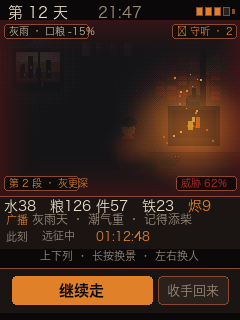
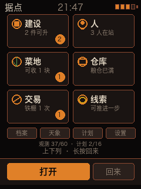
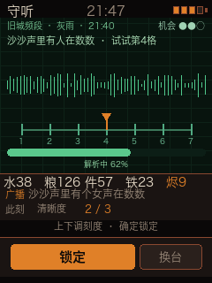

**简体中文** · [English](./UPGRADE_PLAN_20261114.md)

# 《余烬》2.0 · 观测纪元：玩法、动态表现与页面设计升级方案

日期：2026-11-14（Asia/Shanghai）
基线：`feature/ashbox-ember`，HEAD `0dfba4c` 加本轮未提交的审计修复
定位：**提案，不是已排期实现**。所有数值是首版建议，落地前先用宿主推演校准。

---

## 0. 结论先行

**一句话诊断：** 这已经是一个规则完整、数值有盖、离线安全的末世据点经营游戏，但它还不是一款"观测游戏"——玩家在等待段没有东西可看，回来后没有故事可读，屏幕上能发生的变化只有三帧精灵和一行广播。

**一句话方向：** 把"观测"从题材变成机制：让据点自己会动、让世界每天说一句新话、让远征中途有 2 次值得下注的选择、让每个人有心情与交情、让玩家永远看得见"下一件想做的事"。

**五个判断（按性价比排序）：**

| 序 | 判断 | 理由 | 对应升级包 |
| --- | --- | --- | --- |
| 1 | 先做"会动的屏幕"和"回站摘要" | 零新玩法成本，直接改变第一印象与每次回来的获得感 | A、F |
| 2 | 再做"天象 + 守听 + 观测簿" | 用一个确定性的世界层把"观测"做成可收集、可预期、可讨论的内容 | B |
| 3 | 把远征从"一次等待"改成"1–3 段路" | 同样的墙钟时间，决策点从 1 个变 3 个，且不引入第二套时钟 | C |
| 4 | 用"计划"补齐中期目标，用"强度档"修掉后期投入回不了本 | 现有解锁在 3 条线跑完后断档；工坊 3→5 级收益为负 | E |
| 5 | 人物与死亡最后做，但它们是把"游戏"变"作品"的关键 | 现在 6 个人只是属性块，死亡只有一行字 | D |

**建议的第一刀（两周内可上线）：** 升级包 A 全部 + F 的信息架构 + B2 天象 + B4 夜谈 + 回站摘要。它不改存档 ABI，不动第 13 版存档结构，能把"每次回来都有新东西看"立起来。

---

## 1. 现状：这款游戏现在是什么

### 1.1 规模盘点

| 维度 | 现状 | 出处 |
| --- | --- | --- |
| 平台 | ESP32-C3，160 MHz，无 PSRAM，8 MB Flash，ESP-IDF 5.5.3 | `PROJECT.zh_CN.md` |
| 屏幕 | 240×320，16 位色；舞台 240×176；三键（上/下/确定） | `LAYOUT_LOCK.zh_CN.md`、`bsp_button.h` |
| UI | LVGL 9.5，48 KB 内存池，软件绘制 | `sdkconfig.defaults` |
| 固件 | app 2,921,488 B / 8,323,072 B = **35.1%**，余 **64.9%**（约 5.4 MB） | `AUDIT_CODE_20261112.zh_CN.md` |
| 主要占用 | 精灵 ASR1 ≈1.26 MB、PCM 631,884 B、字库位图 106,480 B | 同上 |
| 存档 | `ASH2` v13，blob 776 B，19 条静态断言，只追加字段 | `ashbox_game.h`、`ashbox_save.h` |
| 内容 | 5 档远征、61 条分支、12 标签×5、13 结局、40 条途中句、50 条电台、94 行帮助、3 条调查线×5 拍、15 项建设、12 景×3 帧、6 个人物 | `ashbox_content.c`、`ashbox_ui*.c` |
| 系统 | 口粮/水/零件/铁/余烬、仓、菜地、双营地交易、药品、装备、过路客、日勤、站事、站令、危机、弧线重开、元进度成就 | `ashbox_game.c` |

### 1.2 现在的节奏与数值（推算基线）

| 流 | 数值 | 说明 |
| --- | --- | --- |
| 口粮产出 | 健康人 +4/时 | `apply_economy` |
| 口粮消耗 | 在站人 −1.5/时 | 食堂 3 级 −10%，灶层再 −1 档 |
| 零件产出 | 工坊 1–5 级：**1.0 / 1.5 / 2.0 / 2.4 / 2.8 件/人/时** | `parts_mult_num` 10/15/20/24/28 |
| 威胁 | 基础 **1.5/时**；铁皮线了结后 **1.05/时** | 到 80 约 53 小时；工坊每级 +2 rise |
| 水 | 每人每天 7.5；深坑最多 15/天、水井最多 48/天（日盖） | 3 人时水不是瓶颈 |
| 升级成本 | 宿舍/食堂/工坊：8 / 24 / 60 / 100 / 100 零件 | `k_upgrade_cost` |
| 床位 | 2 / 3 / 4 / 5 / 6 | 人口另受食堂档位与工坊 ≥2 限制 |
| 远征 | 3 分 / 1 时 / 4 时 / 2 时 / 8 时 | 近路/废街/深处/猎场/过夜 |

**关键推论：** 第一天之后，口粮、零件、水都进入溢出区；**真正稀缺的不是资源，而是"下一件新鲜事"**。工坊 3→5 级花 60/100 件只换 +0.4 件/人/时，还每级抬高威胁——后期投入是负收益（审计 C13 仍未关闭）。所以这次升级的重点不是加难度，而是**加目标、加表达、加可选择的风险**。

### 1.3 它已经做对了什么（必须保留）

1. **离线安全**：墙钟结算 + 深睡折算 + 有盖饱和，不逼在线。
2. **规则与 UI 分离**：`ashbox_game.c` 可宿主测试，这是所有新系统的地基。
3. **主题统一**：余烬、匣、灰潮、电台的语气是这款游戏真正的护城河。
4. **诚实的经济**：没有抽卡、没有付费加速、没有清档转生。
5. **像素舞台**：12 景 240×176 是资产，不该只当壁纸。

### 1.4 它现在不够好玩的地方

| 编号 | 级别 | 问题 | 证据 / 体感 |
| --- | --- | --- | --- |
| D1 | S1 | **观测没有机制化**：等待只产生数字；屏幕上没有"值得看的变化" | 主页只有 3 帧/320 ms 的精灵、一行循环广播、一个倒计时 |
| D2 | S1 | **回来的一刻信息不足**：没有回站摘要；战报只覆盖远征，站内几小时的产出/事件不可见 | `report` 只由远征写；`ash_game_settle` 的产出不生成任何叙事 |
| D3 | S1 | **等待段没有决策**：一趟远征只在终点选一次；30 秒会话几乎无事可做 | 远征是单终点；非远征时只有日勤（每日 3 次）与站事 |
| D4 | S1 | **中期目标断档**：3 条线各 5 拍跑完后只剩弧线重开；建设 15 项里后期收益为负 | 审计 C13/C18；工坊 3→5 级 payback 150–250 小时 |
| D5 | S2 | **内容被快速看穿**：12 个标签固定池，同一标签重复出现就是重复答案 | 分支池按标签固定；状态过滤只做了一半 |
| D6 | S2 | **人物是属性块**：6 人无心情、无交情、无个人故事；死亡只有一行字 | `ash_person_t` 只有状态/信任/疲劳 |
| D7 | S2 | **经济后段无压力也无去处**：余烬 17 点出口后堆到 999；零件仓满后只能堆 | 审计 C09/C13 |
| D8 | S2 | **威胁存在感低**：1.5/时、约 53 小时才到 80；危机永远是三个选项 | `maybe_arm_crisis`；`k_crisis_*` |
| D9 | S2 | **页面缺少层级与身份**：21 个页面几乎都是"列表 + 两键"；据点 15 项平铺 | `UI_*` 枚举；`paint_hub` |
| D10 | S2 | **上手靠读，不靠做**：94 行帮助平铺，首局引导是文字页 | `k_help_lines`、`paint_guide_overlay` |
| D11 | S3 | **失败与死亡没有重量**：死亡是一行战报，没有仪式、没有记忆 | `remove_person_at` 只写日志 |
| D12 | S3 | **没有"我见过什么"的记录**：电台 50 句、灰片 4 片，没有档案页 | 无 codex |

---

## 2. 2.0 的设计北极星

### 2.1 玩家一句话

> **你守着一盏火，听着门外的世界。每次回来，都有一件事等你看见；每次离开，都留下一个想解开的谜。**

### 2.2 五条支柱

| 支柱 | 要解决的问题 | 玩家感受 | 归属升级包 |
| --- | --- | --- | --- |
| **P1 会呼吸的据点** | 屏幕是死的 | "它在我离开的时候也在活着" | A |
| **P2 值得一听的世界** | 观测不是玩法 | "今天外面又说了什么" | B |
| **P3 有去有回的远征** | 等待没有决策 | "再走一段，还是收手" | C |
| **P4 有人味的人** | 人物是数值 | "我不想让小芒出事" | D |
| **P5 永远有下一件** | 中期目标断档 | "再攒两天就能修广播了" | E |

### 2.3 三种会话长度的目标

| 会话 | 玩家应该完成 | 目标时长 | 现状 |
| --- | --- | --- | --- |
| **回来看一眼** | 读到 1 条变化；收账；派出下一趟 | 20–40 秒 | 只有倒计时/战报，无摘要 |
| **坐一会儿** | 守听 1 次；做 1 件站务；花掉资源 | 2–4 分钟 | 日勤 3 次/天，其余靠翻页 |
| **认真玩一段** | 处理危机；推进计划；经历一段人物戏 | 15–25 分钟 | 只有危机与建设 |
| **一天** | 1 个天象、1–2 段信号、1 拍调查、1 位来客、1 个计划节点 | 墙钟 | 只有调查拍与来客 |
| **一周** | 完成 1 个计划、1 条个人线、1 条弧线 | 墙钟 | 只有弧线 |

**验收口径：** 任意时刻打开设备，主页至少要有 **2 个可做的动作** 和 **1 条新信息**；没有远征、没有危机、没有战报时也不允许出现"无事可做"。

### 2.4 不做什么（硬轨）

1. 不做内购、广告、抽卡、加速券、每日签到惩罚。
2. 不做清档转生/赛季重置；弧线重开保留。
3. 不引入"必须在线才涨"的资源；所有新系统离线可结算或有盖。
4. 不加第二套时钟；新系统全部挂在 `ash_game_settle` 与现有页面上。
5. 不缩小 240×176 舞台、不砍景/砍帧、不做有损美术。
6. 不增加超过两层的菜单深度；三键可达性优先。
7. 不把工程词写进玩家文案（芯片/总线/框架/引擎）。

---

## 3. 升级包 A：会呼吸的据点（动态表现层 2.0）

> 目标：**零新玩法也能让屏幕活起来**；所有效果可分级关闭，省电优先。
> 不改布局锁：所有新元素都是叠在 240×176 舞台上的 HUD 与粒子，不移动既有几何。



### A1 舞台 HUD（游戏化浮层）

在舞台四角叠 4 个半透明信息片，替代"所有信息都挤在 52 px 信息带"：

| 位置 | 内容 | 出现条件 |
| --- | --- | --- |
| 左上 | 天象图标 + 名称（如「灰雨」）+ 一句影响（「口粮 −15%」） | 常驻 |
| 右上 | 守听状态：「◉ 守听 2」/「静默」 | 有信号窗口时闪烁 |
| 左下 | 远征段位与剩余时间：「第 2 段 · 灰更深」/「回来 01:12」 | 远征中 |
| 右下 | 威胁值：`威胁 62%`，≥80 时红底脉冲 | 威胁 ≥50 才显示 |

规格：每个 56–86×14 px，圆角 3，底色 `COL_SURF` 不透明度 85%，1 px `COL_LINE` 边；文字 10–11 px。四角浮层不遮挡舞台中心（人物/火堆/门）。

### A2 昼夜色温（1 个对象，收益最大）

在舞台上叠 1 个全幅矩形，按墙钟改变颜色与不透明度：

| 时段 | 颜色 | 不透明度 |
| --- | --- | --- |
| 05:00–07:00 黎明 | `#FF9A5A` | 25% |
| 07:00–17:00 白天 | 透明 / 暖白 | 0–8% |
| 17:00–20:00 黄昏 | `#E06028` | 30% |
| 20:00–05:00 夜 | `#101840` | 45% |

天象可覆盖（灰雨 +18% 灰、长雾 +15% 米白）。每 60 秒最多更新一次，避免全屏重绘。

### A3 天象粒子与天气（10–18 个对象）

固定对象池，按天象启用，8–10 fps，只在家里与 PWR_ACTIVE 时运行：

| 效果 | 对象数 | 实现 | 触发 |
| --- | --- | --- | --- |
| 余烬上升 | 10 | 3×3 点，沿火堆上方漂移，透明度按寿命；**余烬库存越多越密**（最多 14） | 常驻 |
| 灰雨 | 8 | 2×6 竖条，向下 2 px/帧，循环 | 灰雨 |
| 长雾 | 3 | 240×22 横带，透明度 12–18%，左右漂移 | 长雾/灰雨 |
| 沙尘 | 12 | 2×2 点，横向漂移 | 沙尘/铁风 |
| 霜/星 | 6 | 1×1 点闪烁 | 霜降/星落/月白 |
| 火光呼吸 | 2 | 24/48 px 圆，透明度 40–90 正弦 | 有灶火 |
| 威胁暗角 | 4 | 四边渐变条，红色；≥50 时 2 秒脉冲，≥80 时 0.8 秒 | 威胁 ≥50 |

火堆坐标按场景给一张 12 项锚点表（`{x, y}`），不靠猜。

### A4 转场与"手感"（juice）

| 效果 | 规格 | 成本 |
| --- | --- | --- |
| 数字跳动 | 资源变化时 1.0→1.15→1.0，180 ms，琥珀色；同屏复用 1 个浮动 `+N` 标签 | 1 个标签 |
| 条/徽章反馈 | 威胁条、资源条变化时闪 1 次；危机到达时整屏 1 px 抖动 2 次 | 0 |
| 按键反馈 | 按下 40 ms 内缩 1 px + 音效；长按有进度提示 | 0 |
| 页面转场 | 前进右侧滑入 120 ms，返回左侧滑出；弹窗淡入+缩放 100 ms | 1 个遮罩 |
| 场景切换 | 240 ms 交叉淡入（叠 1 个与旧帧同源的快照会吃 RAM，改用 80 ms 黑场过渡） | 0 |
| 入睡 | 背光 600 ms 降到 0，舞台上留 1 个余烬点渐暗 | 0 |

原则：**氛围动画慢（0.1–0.4 Hz），事件反馈快（<200 ms）**；任何动画不得延迟按键响应，不得在 PWR_DIM 之后继续。

### A5 电台可视化

信息带的「广播」左侧加 6 根 2×8–14 px 的小柱，音频任务说话时随机起伏（由 `ashbox_sfx` 暴露 `bool ashbox_sfx_radio_speaking(void)`），静默时压平。让"电台活着"这件事看得见，而不只是听见。

### A6 性能预算与降级

| 项 | 预算 | 降级 |
| --- | --- | --- |
| 动画对象 | ≤24 个常驻，≤40 个瞬时 | 设置里 4 档：高/中/低/关 |
| 帧率 | 家里 10 fps；列表页 0 | 中：仅色温+火光；低：仅色温；关：静态 |
| CPU | 单帧绘制 ≤8 ms；动画总占用 ≤12% | 超预算自动降一档并记日志 |
| 内存 | 不新增全帧缓冲；只用 LVGL 对象 | 池 48 KB → 64 KB 需实测 |
| 功耗 | DIM 后全停；BLANK 后不重绘 | 与现有省电状态机绑定 |

**验收：** 连续 10 分钟家里动画，`lv_mem` 不下降、无碎片化失败；帧耗时日志 P95 <8 ms；电池 4 小时掉电不超过现版本 10%。

---

## 4. 升级包 B：值得一听的世界（观测循环）

> 这是 2.0 的身份系统：把"看"变成"发现"，把"发现"变成"记录"，把"记录"变成"理解"。
> 三个子系统都确定性、可离线、有盖、不惩罚缺席。

### B1 守听（信号扫描）

**四个波段**，按进度解锁：

| 波段 | 解锁 | 内容基调 |
| --- | --- | --- |
| 旧城 | 开局 | 旧城熄灯前后、货亭、地铁 |
| 铁棚 | 通联铁棚 | 营地人声、交换、警告 |
| 灰河 | 通联渡口 | 潮声、渡口、河对岸 |
| 门后 | 开闸 | 门后风、灰潮、低频怪声 |

**每日窗口：** 每天 2 个窗口，由 `day_key` 确定性生成（一个在 19:00–01:00，一个在 09:00–15:00，各持续 3 小时）。窗口内守听有额外「清晰」加成；错过可在 **1 天内回放**，回放只给档案与叙事，不给机制加成。这样既不 FOMO，又奖励在场。

**一次守听的流程（20–40 秒）：**

1. 选波段（左右），显示强度条与一句质感提示（「沙沙声里有人在数数」）。
2. 调刻度：7 格（清晰度升级后减到 5/4/3），上下移动；每格给不同的噪声与提示。
3. 确定锁定：命中 ±1 格即解析成功；每次窗口 3 次机会。
4. 解析 6 秒（可跳过）：波形 + 进度 + 静电音。
5. 结果四选一：

| 结果 | 内容 | 价值 |
| --- | --- | --- |
| 旧闻 | 1 条世界观文本 | 观测簿 +1 |
| 地标 | 明日天象 / 一个隐藏物资点 | 计划性 |
| 人声 | 某位幸存者的一段过去 | 交情 / 个人线 |
| 空白 | 只有静电 | +1「残响」 |

**残响（Resonance）**：0–3 上限，守听失败或空白积累；下次出发前可花 1 点选一项：多 1 次掉落判定 / 空手率 −5 个百分点 / 预览下一段风险 / 提前结束不损失。**只影响一趟，不叠加、不滚雪球。**

**清晰度**：每波段 0–3 级，每 3 次成功 +1；等级越高刻度越少、结果档位越高。这是"观测"的长线精通，不产出战力。

**上限：** 每日 2 次（修好发报机后 3 次）；残响 ≤3；无付费、无广告。

### B2 天象（每日世界状态）

**确定性**：用 16 天一个排列，保证 16 个天象在 16 天内各出现一次，不乱序、不连续重复。`phenom(day_key) = k_perm[day_key % 16]`。不需要存档字段，重载不会重摇。

| 天象 | 效果（首版建议） | 画面 |
| --- | --- | --- |
| 空晴 | 无修正；守听清晰 +1 档 | 干净夜色 |
| 灰雨 | 产水 +50%；户外口粮 −15%；热伤概率 +5 pp | 灰雨粒子 |
| 铁风 | 零件 +30%；远征铁 +1；威胁 +10% | 横向风线 |
| 静夜 | 夜间威胁 −50%；心情 +2 | 深蓝 |
| 霜降 | 菜地生长 +30%；耗水 −20% | 白霜点 |
| 长雾 | 空手率 +5 pp；灰片概率 +1 档 | 雾带 |
| 回声夜 | 守听结果 +1 档；夜间多 1 个窗口 | 回声波纹 |
| 热风 | 耗水 +30%；热伤 +5 pp | 橙红色温 |
| 断电夜 | 电台/守听关闭；威胁 +20%；来客 +1 | 全黑只留一盏灯 |
| 月白 | 夜间远征掉落 +15%；心情 +2 | 月光 |
| 潮涨 | 渡口多 1 次交易；水 +10 | 水波 |
| 沙尘 | 零件 −20%；威胁 −10% | 沙粒 |
| 死寂 | 无来客、无信号；心情 −3 | 画面静止 |
| 星落 | 灰片 +1；档案概率 | 星点 |
| 灰潮前兆 | 威胁 +50%；危机阈值 −10；深处掉落 +20% | 红雾 |
| 暖流 | 口粮 +20%；心情 +2 | 暖色 |

**预告**：明天免费可见（这是最强的"明天再来"钩子）；修好瞭望台后可见 3 天。危险天象（灰潮前兆、热风、断电夜）在预告页用危险色标出，并给一句"该做什么"。

**结算**：`ash_game_settle` 在本地零点处分段，最多 3 段（DT 上限 36 小时），每段套用当天的天象；这样离线跨天也正确。所有修正只乘在产出/消耗/概率上，仍走饱和与有盖。

### B3 观测簿（Codex）

**5 个分卷、首版 60 条**：

| 分卷 | 条数 | 例子 |
| --- | --- | --- |
| 世界 | 12 | 灰潮是什么、旧城为什么熄灯、门后有什么、余烬从哪来 |
| 地方 | 10 | 近路、废街、深处、猎场、铁棚、渡口、前哨、门后 |
| 人 | 12 | 阿禾、老阙、小芒、灰皮、夜行、旧靴、8 类来客 |
| 物 | 14 | 药品、撬棍、手枪、子弹、种子、灰片、信物、超级核心 |
| 事 | 12 | 三次了结、弧线、死亡、第一次开闸、第一次来客… |

每条：标题 + 2–3 行正文 + 一句"怎么发现的"提示；未解锁显示 `???` 与提示。解锁条件由现有状态/事件触发，不重复计。

**观测度**：每条 1–3 点，满分约 120；每 25% 解锁一个称号（守夜人/听风者/记录者/见证者），称号只显示在人物页与设置页，不给数值。**这是纯收集，不制造压力。**

### B4 夜谈（回站小段）

每天第一次回站（或离开 >4 小时）时，弹一段 3–4 行的夜间小戏，2 个选择，每个选择给一点心情/交情/小资源/一条档案。首版 24 段，按状态过滤（有菜地/有来客/有人受伤/有人交情深/威胁高）。**每天最多 1 段，无失败，不打断远征结算。** 复用现有弹窗与选项机制，不需要新页面。

这是"回来有故事"的最低成本实现：玩家记住的往往不是数值，而是某一晚谁在门外咳嗽。

### B5 上限与不做

- 守听 2 次/日（3 次）；残响 ≤3；夜谈 1 段/日；天象 1 个/日。
- 观测簿不产出战力；称号无数值。
- 不做需要实时在线的窗口；回放机制保证缺席不吃亏。

---

## 5. 升级包 C：有去有回的远征（1–3 段路）

> 同样的墙钟，把"等待"变成"下注"。不新增时钟，不改档位时长。

### C1 走法（出发前的一个真选择）

| 走法 | 掉落 | 空手率 | 时长 | 威胁 |
| --- | --- | --- | --- | --- |
| 稳走 | ×0.85 | −20%（相对） | ×1.0 | 无 |
| 快走 | ×1.0 | +10% | ×0.85 | 无 |
| 贪走 | ×1.35 | +25% | ×1.0 | 成功归来 +2 |

出发页用一行白话写清「空手而归的概率约 X%」，并在选人页显示该人加成后的真实数字（已有 `ash_game_depart_fail_pct`）。

### C2 路段（legs）

| 档 | 段数 | 分段点 | 中途选择 |
| --- | --- | --- | --- |
| 近路 3 分 | 1 | — | 无 |
| 废街 1 时 | 2 | 50% | 继续 / 收手 |
| 深处 4 时 | 3 | 40% / 75% | 继续 / 收手 / 绕路 |
| 猎场 2 时 | 2 | 50% | 继续 / 收手 |
| 过夜 8 时 | 2 | 55% | 继续 / 收手 |

**规则：**

- 每过一段，累积该段掉落（先入"携带"，不回站不入账）。
- 段末醒着：弹「途中」卡，2–3 个选项，显示风险与已带战利品；**默认不预选**（防误触，沿用战报页的 `-1` 起始）。
- 段末在睡/离开：按走法自动继续（稳=收手，快/贪=继续），不惩罚离线。
- 收手：保留当前 60% 携带，跳过剩余段的风险；余烬只在最后一段有概率。
- 继续：+1 次掉落判定，下一段空手率 +8 个百分点；深处第 3 段额外 +1 灰片概率。
- 重伤/死亡按段结算；手枪在段内遭遇时消耗子弹。

**玩家感受：** 4 小时的深处不再是"点完就走"，而是回来两次、各做一次小决定；30 秒会话也能处理"第 2 段到了"。

### C3 战报 2.0

```
有人回来了
最远到：旧地铁 3 号口
带回：口粮 11 · 零件 2 · 铁 6 · 灰片 1
代价：阿禾轻伤 · 弹药 1
〔分给站里〕〔先藏私货〕〔修风扇〕
```

标题按结果变化：`有人回来了` / `空手而归` / `有人没回来` / `只回来了一半`。资源用 4 个彩色 chip，叙事 2 行，分支卡片 2–3 个，每张卡显示代价与结果预览（把现有 `ash_game_branch_effect` 扩成两行）。死亡时先播一段 3 行悼词，再进分支。

### C4 数值与存档

- 新字段：`exp.leg`、`exp.leg_total`、`exp.stance`、`exp.carry_food/parts/ember/iron`、`exp.leg_waiting`（段末待选）、`exp.leg_choice`。
- 迁移：v13 进行中的远征按 `leg=0` 处理，直接走旧逻辑到终点；不打断存档。
- 测试：每档每段的分段点、收手保留比例、自动继续策略、跨深睡恢复。

---

## 6. 升级包 D：有人味的人（心情、交情、个人线）

> 目标：让玩家在派谁出门时犹豫，在有人没回来时难受。

### D1 心情（0–100）

| 事件 | 变化 |
| --- | --- |
| 每天吃饱有水 | +2 |
| 被派远征 | −6 |
| 受伤/感染 | −10 |
| 交情深的人死亡 | −15 |
| 吃到干肉/熟食 | +8 |
| 完成个人线/计划 | +10 |
| 天象：静夜/月白/暖流/铺石子路 | +2 |

**档位效果：** 低落（<30）产出 −10%、空手率 +3 pp；有劲（≥70）产出 +5%、伤愈 +20%、夜谈更容易出现。**不做心情崩溃/离站**，避免惩罚性。

### D2 交情（pair bond 0–3）

- 两人同站、同工种/同守夜，每天 +1；个人线 +2。
- 交情 ≥2：同工种产出 +8%；交情 3：解锁共同小戏 + 夜谈选项。
- 交情是双向的，存 6×6 上三角（15 个半字节 = 8 B）。

### D3 个人线（6 人 × 3 拍）

触发条件：交情/心情/特定天象/特定地点。形式：2–3 行场景 + 1 个选择。奖励是**独特能力，不是倍率**：

| 人 | 三拍主题 | 了结能力 |
| --- | --- | --- |
| 阿禾 | 掌灯、劝人、旧名字 | 交涉守夜额外 −10 威胁（每危机 1 次） |
| 老阙 | 拆门、修炉、手抖 | 加固闸门零件 −25%（永久） |
| 小芒 | 记路、怕黑、长大 | 每 2 天标出 1 个隐藏物资点 |
| 灰皮 | 灰里来、灰里去、留下 | 夜间远征 +1 铁 |
| 夜行 | 守夜、耳鸣、天亮 | 守听每日 +1 次 |
| 旧靴 | 走货、欠账、回站 | 来客更常来（每周 +1） |

### D4 过路客 2.0

来客有档案（来处、想要什么、能带来什么），3 个选项：留下 / 交易 / 打发。不同的打发方式影响交情与后续来访；8 类来客写进观测簿。加入「来客簿」页（可并入观测簿「人」卷）。

### D5 死亡与纪念

- 死亡不再是一行战报：舞台压暗 400 ms → 3 行悼词 → 全员心情 −15 → 遗物入仓 → 观测簿 +1（墓志）。
- 观测簿新增「纪念」小节，列出每个离开的人、一句由特性与最后工作生成的墓志。
- 葬礼夜谈 1 段（只在有死亡的下一天出现）。

### D6 存档

`mood[6]`（6 B）、`bond[15]` 半字节（8 B）、`arc_step[6]`（6 B）、`arc_done`（u16）、`memorial_mask`（u16）、`vignette_day`/`vignette_choice`。约 25 B。

---

## 7. 升级包 E：永远有下一件（目标与经济）

### E1 计划（16 项，玩家自定节奏）

计划不是"任务"，是**看得见的长期目标 + 自愿的资源沉淀**。资源可以分批献（每次 ±5），进度条常驻；同一时间允许多个计划并行。

| # | 计划 | 成本 | 解锁 | 玩法变化 |
| --- | --- | --- | --- | --- |
| 1 | 补屋顶 | 件 30 | 床位 +1 | 人口上限 |
| 2 | 修广播 | 件 45 · 铁 10 | 天象预告 3 天；守听窗口提示 | 计划性 |
| 3 | 砌灶台 | 件 40 | 口粮耗 −5%；熟食心情 | 经济 |
| 4 | 挖地窖 | 件 60 | 仓 +60；腐坏减半 | 仓储 |
| 5 | 搭瞭望台 | 件 50 · 铁 15 | 危机预警 1 天 | 风险 |
| 6 | 建水槽 | 件 55 | 水上限 +20 | 水 |
| 7 | 药柜 | 件 40 · 抗生素 2 | 伤愈 +25%；药位 2 | 医疗 |
| 8 | 发报机 | 件 80 · 铁 20 | 每日邀请 1 位来客 | 人物 |
| 9 | 暖炉改造 | 铁 30 · 烬 4 | 夜间威胁 −20% | 守夜 |
| 10 | 长明灯 | 烬 1/日 | 夜间不减产；心情 + | 余烬沉淀 |
| 11 | 工具架 | 件 70 | 撬棍 +5；制作 −10% | 工具 |
| 12 | 前哨 | 件 200 · 铁 60 | 远行档 + 第二远征位 | 终局 |
| 13 | 温室 | 件 120 · 种子 3 | 新作物：药草 | 新资源 |
| 14 | 档案馆 | 件 90 | 档案提示；观测度加成 | 收集 |
| 15 | 重铸大门 | 铁 80 · 烬 6 | 威胁地板 −5；新场景 | 终局 |
| 16 | 铺石子路 | 件 50 | 心情 +；来客 + | 氛围 |

**排序原则：** 每 3 个计划里至少有 1 个改变"怎么玩"（新页/新动作/新选择），而不是只给倍率。前 6 个覆盖开局 8 小时，保证每 60–90 分钟有一个新目标。

### E2 后期沉淀（修掉 C09/C13）

| 沉淀 | 成本 | 回报 | 目的 |
| --- | --- | --- | --- |
| 长明灯油 | 烬 1/日 | 夜间威胁 −10%、心情 + | 余烬持续出口 |
| 保养 | 件 5/日 | 24 小时产出 +10% | 零件持续出口 |
| 改装 | 件 40 + 铁 10 | 三选一：消音（威胁 −，掉落 −）/ 瞄具（猎场 +，速度 −）/ 加固（防伤 +，负重 −） | 取舍而非纯增益 |
| 声望捐赠 | 件/粮/水 | 营地声望 3 级；解锁独特交易与档案 | 关系 |

### E3 修掉后期负收益：工坊强度档

现在工坊每升 1 级 `threat_rise_num +2`，3→5 级花 160 件只换 +0.8 件/人/时，还加速威胁——**升级是惩罚**。改为：

- **升级纯增益**：工坊 2–5 级为 1.5/2.0/2.4/2.8 件/人/时（不变），不再加威胁。
- **新增强度档（稳/常/猛）**：产出 ×0.85/1.0/1.25，威胁 ×0.9/1.0/1.2。玩家自己选"要产量还是要安静"。
- 成本改为 8/16/36/60，payback 分别约 16/32/75/125 小时；后两级仍偏长，用"强度档 + 计划 + 保养"补回报，而不是继续降成本。

### E4 终局：前哨

修好「前哨」后解锁一张小地图：前哨可存 60 口粮/30 水，远征可从前哨出发（少 20% 时长），也能成为第二个远征位（同一时间两趟，但每趟掉落 −15%）。这是继"弧线重开"之后的第二个长期目标，且完全离线。

### E5 成就 5 → 16

新增：首次开闸、首次通联、首次了结、观测度 25/50/75/100%、10 次守听、5 位来客、1 条个人线、前哨建成、无死亡通关、只用近路通关、集齐 16 天象。成就只给称号与档案，不给数值。

---

## 8. 升级包 F：页面设计 2.0

### F1 信息架构：15 项平铺 → 6 张卡 + 4 个入口

| 现在（据点一列 15 项） | 2.0（两列 6 卡 + 4 入口） |
| --- | --- |
| 日勤 / 菜地 / 资源 / 仓库 / 人物 / 装备 / 交易 / 站令 / 线索 / 成就 / 纪事 / 设置 / 帮助 / 建设 | **建设 · 人 · 菜地 · 仓库 · 交易 · 线索**；下方小入口：**档案 / 天象 / 计划 / 设置** |

每张卡显示 1 个状态副行与 1 个角标（可升级 2 / 可收 1 / 仓满 / 可推进）。卡片 = 图标 + 标题（16 px）+ 副行（10 px）+ 角标；2×3 网格，卡 104×56，间距 8。

### F2 设计系统

| 项 | 规格 |
| --- | --- |
| 网格 | 4 px；页边距 12；内容宽 216 |
| 字号 | 标题 16；正文 16；副文 12；角标/浮层 10（新增 12 px 字库子集） |
| 颜色 | 现有 `COL_*` 不变；新增「危险底色」`#2A1010`、「档案底色」`#121A18` |
| 卡片 | 圆角 5；1 px 边；选中时左缘 3 px 琥珀条 + 底色 `COL_SEL` + 2 px 外环 |
| 焦点 | 不用纯颜色表达：选中行加 `▶` 与左条；保证色弱可辨 |
| 滚动 | 右侧 4 px 轨道 + 滑块；标题旁显示 `3/15` |
| 空状态 | 一句人话 + 下一个解锁条件，不留白 |
| 图标 | 12×12 单色像素图标 12 枚（约 1.7 KB），按页复用 |

### F3 页面线框（关键页）

**家园**（几何不变）：

```
┌ 第12天            21:47      电芯匣 ┐
│ ┌灰雨·口粮-15%┐        ┌◉守听·2┐ │ 176 舞台
│ │            火堆/人物            │ │
│ └第2段·灰更深┘        └威胁62%┘ │
├ 水38  粮126  件57  铁23  烬9 ────┤ 52 信息带
│ 广播 ▮▮▮ 灰雨天 · 潮气重 · 添柴   │
│ 此刻 远征中 · 第2段  01:12:48     │
└ 上下列 · 长按换景 ────────────────┘
   〔继续走〕        〔收手回来〕
```

**据点**：2×3 卡 + 4 入口 + 一行"观测 37/60 · 计划 2/16"。



**守听**：全屏调谐（刻度和波形占满舞台区），下方保留资源带。



**建设**：4 个分页（住 / 产 / 守 / 水工），左右换页，上下列；每行 36 px，右侧代价 chip。

**人物**：列表行 = 名字 + 状态 chip + 心情脸 + 工种；详情 = 三个小页（状态 / 交情 / 故事）。

**观测簿**：分卷列表（5 卷 + 完成度）→ 条目列表（已解锁/未解锁）→ 阅读页（2–3 行 + 出处）。

**天象**：今天的大卡 + 明天/后天的三格；每条给一句"该做什么"。

**守听**：全屏调谐，刻度 + 波形 + 提示 + 机会，见下图。

**战报 / 危机**：全屏、无默认选中、代价与结果预览；危机用红底暗角与 0.8 秒脉冲。

### F4 三键可达性规则

1. 从主页到任何功能 ≤2 层。
2. 左右 = 换页/换卡/换选项；上下 = 列表；确定 = 执行；长按确定 = 返回/深睡。
3. 每个页面必须有可见出口（底栏或提示），不允许"只能长按退出"。
4. 破坏性操作（用核心、清档、导入）必须二次确认，且默认停在"取消"。
5. 任何列表首项不默认选中（防连按误触），沿用战报页的 `-1` 起始。

### F5 文案约束

- 240 px 宽、16 px 中文 = 每行 **≤15 字**；卡片副行按 12 字写。
- 所有新文案先写"人话"，再压到 12 字；用 `ash_copy_utf8` 与 `check_ashbox_copy_layout.py` 门禁。
- 新中文字形必须进 `main/ashbox_font_symbols.txt` 并重生 12/16 px 子集。

---

## 9. 上手与节奏

### 9.1 前 10 分钟（6 拍）

| 拍 | 玩家动作 | 教学方式 | 目标 |
| --- | --- | --- | --- |
| 1 | 按确定点火 | 舞台上 1 个高亮 chip | 10 秒内看到反应 |
| 2 | 升宿舍到 2 级 | 底栏直接给"升级"动作，8 件已有 | **首次升级 <60 秒** |
| 3 | 派阿禾走近路 | 选路页只显示 1 档，副行写"3 分钟" | 30 秒内出发 |
| 4 | 回来选分支 | 战报先读结果再选，默认不选 | 理解"选择有代价" |
| 5 | 收到第一段夜谈 | 2 个选择，都有小反馈 | 理解"人" |
| 6 | 听到第一段信号 | 引导调 1 次刻度 | 理解"观测" |

旧的 94 行帮助保留，但改为 **6 个分节 + 每节 3 行**，只在玩家主动打开时出现；不再作为首局主教学。

### 9.2 回站摘要（Return Digest）

离开超过 30 分钟再回来，先给 1 屏摘要（可一键跳过）：

```
你离开了 7 小时 12 分
产出：口粮 +34 · 零件 +12 · 水 +26
发生：灰雨（产水+50%）· 小芒心情低落 · 仓满了
等你：战报 1 · 守听窗口 1 · 计划「修广播」可献料
```

三行、四个数字、一个按钮。这是"放置游戏"最重要的一个页面，成本极低，收益极高。

### 9.3 通知与角标

- 顶栏保留一个角标，但按类别着色：战报（琥珀）/危机（红）/可收（绿）/观测（青）。
- 据点卡片的角标与顶栏联动；同一事件不在两处重复计数。
- 深睡唤醒时，若摘要里有"危机/死亡/计划完成"，先亮屏再播提示音。

---

## 10. 工程方案

### 10.1 新模块（保持规则/UI 分离）

| 模块 | 职责 | 依赖 |
| --- | --- | --- |
| `ashbox_phenom.c/h` | 天象表、确定性取日、修正值、预告 | 纯函数，可宿主测 |
| `ashbox_signal.c/h` | 波段、窗口、刻度、清晰度、结果表、残响 | 纯函数 + 随机 |
| `ashbox_codex.c/h` | 条目表、解锁判定、观测度、称号 | 纯函数 |
| `ashbox_project.c/h` | 计划表、献料进度、解锁副作用 | 纯函数 |
| `ashbox_social.c/h` | 心情、交情、个人线、夜谈、来客档案 | 纯函数 |
| `ashbox_exped.c`（或 game.c 内） | 路段、走法、携带、段末选择 | 复用现有 exp |
| `ashbox_stage.c/h` | 舞台浮层、色温、粒子、降级 | LVGL |
| UI 单元 | `ashbox_ui_stage/codex/forecast/projects/signal/social/digest.c` | 只画，不写规则 |

### 10.2 存档 v14（只在 M4 之后升）

| 字段 | 类型 | 字节 |
| --- | --- | --- |
| `exp.leg` / `leg_total` / `stance` | u8×3 | 3 |
| `exp.carry_food/parts/ember/iron` | u16×4 | 8 |
| `exp.leg_waiting` / `leg_choice` | u8×2 | 2 |
| `mood[6]` | u8×6 | 6 |
| `bond[15]` | 半字节×15 | 8 |
| `arc_step[6]` / `arc_done` | u8×6 + u16 | 8 |
| `watch_clarity[4]` | 半字节×4 | 2 |
| `resonance` / `scan_count` / `scan_day` | u8/u8/u16 | 4 |
| `phenom_seen` | u16 | 2 |
| `codex_mask` | u64 | 8 |
| `project_progress[16]` / `project_done` | u16×16 + u32 | 36 |
| `vignette_day` / `vignette_choice` / `memorial_mask` | u16/u8/u16 | 5 |
| `lamp_fuel` / `intensity` / `mods` | u8×3 | 3 |
| 对齐 pad | — | 2–6 |

合计约 **100 B**；blob 776 → 约 880 B。迁移：v13→v14 全部默认 0，`phenom_seen=0`、`intensity=常`、`project_progress=0`；进行中的远征按旧逻辑跑完。新增 v14 冻结夹具 + 静态断言；v13 夹具保留。

**M1/M2 不改 ABI**：表现层、摘要、天象（纯函数，无需存档）、夜谈（可只用 `day_latch` 空闲位）都不动结构。

### 10.3 Flash / RAM / 性能预算

| 项 | 估算 | 余量 |
| --- | --- | --- |
| 新文本（16 天象 + 60 档案 + 16 计划 + 48 信号 + 24 夜谈 + 18 个人线 + 27 分支 + 40 电台 + 46 帮助） | ≈ 80–120 KB | 5.4 MB 余量，充足 |
| 字库（新增 12 px 子集 + 新字） | ≈ 60–90 KB | 充足 |
| 图标 12 枚 | ≈ 2 KB | 充足 |
| LVGL 对象 | +24 常驻浮层；新页复用行对象 | 池 48 → 64 KB 需实测 |
| RAM | 不新增全帧缓冲；粒子位置用静态数组 | bss 现 147 KB，余量可 |
| CPU | 动画 P95 <8 ms/帧；10 fps 家中 | 需上机测 |

### 10.4 测试矩阵

| 层 | 内容 |
| --- | --- |
| 宿主单测 | 天象确定性/修正、跨日结算分段、守听窗口/上限/清晰度、观测簿解锁、计划进度、心情/交情数学、路段结算、v13→v14 迁移、上限饱和 |
| 推演 | 扩展现有 `tools/sim_ashbox_roles.c`：72 小时脚本策略，断言首次升级时间、解锁间隔、无死锁、无溢出 |
| 门禁 | `./tools/validate.sh --static`、`--firmware`、字库、文案布局、术语表 |
| 真机 | 走屏（家园/据点/建设/档案/天象/守听/战报/危机）、10 分钟动画内存、4 小时掉电、深睡唤醒摘要 |

**平衡断言（关键）：**

- 首次升级 ≤60 秒。
- 开局 8 小时内，任意 90 分钟窗口至少有 1 个新解锁/新目标。
- 3 人站、无远征时，任意时刻至少 2 个可做动作。
- 工坊 2–5 级的 payback 单调不恶化（在强度档"常"下）。
- 16 天内 16 个天象各出现 1 次。
- 观测簿 100% 需 20–30 小时，且不依赖运气极端值。

### 10.5 风险

| 风险 | 概率 | 影响 | 缓解 |
| --- | --- | --- | --- |
| 范围过大 | 高 | 做不完 | 6 个里程碑，每个可独立上线；M1/M2 不改 ABI |
| 三键菜单变深 | 中 | 难用 | ≤2 层；每页可见出口；真机走屏后再加页 |
| 存档迁移回归 | 中 | 老档损坏 | 冻结夹具 + 迁移测试 + 保档刷机脚本 |
| LVGL 内存/性能 | 中 | 卡顿/崩溃 | 对象池、降级档、`lv_mem_monitor` 日志门禁 |
| 天象影响平衡 | 中 | 某些天象过强 | 只乘在现有流上、有盖、sim 断言 |
| 文案超宽 | 高 | 截断 | 12 字副行规则 + 现有门禁 + 新字库检查 |
| 美术依赖 | 中 | 新场景/图标卡住 | 阶段 2 全部用程序化浮层，不依赖新 sprite |

---

## 11. 路线图

| 里程碑 | 范围 | 产出 | 估算 |
| --- | --- | --- | --- |
| **M1 会动** | A1–A5 + 回站摘要 + 数字跳动 | 屏幕第一印象改变；不改 ABI | 3–4 人日 |
| **M2 世界** | B2 天象 + 预告 + 昼夜/天气 + F1/F2 信息架构 + 据点/建设页 | "每天不一样"；不改 ABI | 5–7 人日 |
| **M3 观测** | B1 守听 + B3 观测簿（首版 30 条）+ B4 夜谈 + 成就 3 位 + 新手上手 | 身份系统成立；v14 首次升版 | 7–10 人日 |
| **M4 下注** | C 远征分段 + 走法 + E1 前 6 个计划 + E3 工坊强度档 | 决策密度翻倍 | 8–12 人日 |
| **M5 人** | D 心情/交情/个人线/来客 2.0/死亡纪念 | 情感重量 | 8–12 人日 |
| **M6 终局** | E1 后 10 个计划 + E2 沉淀 + E4 前哨 + 平衡/真机 | 长线目标 | 5–8 人日 |

**建议先做 M1+M2**：它们不改存档、不依赖新美术、能立刻验证"动态表现 + 回站摘要 + 天象"是否真的让每次回来更有意思。M3 是身份，M4 是深度，M5 是作品感，M6 是长线。

---

## 12. 验收指标（可测）

| 指标 | 目标 |
| --- | --- |
| 首次升级 | ≤60 秒 |
| 每次回站可见变化 | ≥1 条（摘要/天象/战报/计划/夜谈） |
| 30 秒会话可完成的有意义动作 | ≥2 个 |
| 开局 8 小时解锁间隔 | ≤90 分钟 |
| 无"无事可做"状态 | 3 人站、无远征、无危机时仍 ≥2 个动作 |
| 观测簿 100% | 20–30 小时 |
| 16 天象覆盖 | 16 天内各 1 次 |
| 工坊 payback | 2–5 级不恶化 |
| 动画内存 | 10 分钟无 `lv_mem` 失败 |
| 掉电 | 4 小时 ≤ 现版本 +10% |

---

## 13. 参考与依据

**本仓：**

- [游戏内容审计（2026-11-08）](./AUDIT_GAMEPLAY_20261108.zh_CN.md) · [代码审计（2026-11-12）](./AUDIT_CODE_20261112.zh_CN.md)
- [延伸设计](./EXTENSION.zh_CN.md) · [内容填充](./CONTENT_FILL.zh_CN.md) · [Flash 方案](./FLASH_SIZE_PLAN.zh_CN.md) · [布局锁](./LAYOUT_LOCK.zh_CN.md)

**外部（仅作设计参考）：**

- [Incremental / Idle — Design Codex](https://hayao.dev/docs/codex/genre-incremental)：无"解锁沙漠"、payback 不恶化、每层新机制、不能惩罚离线。
- [A Dark Room 的设计历程](https://www.gamedeveloper.com/design/-i-a-dark-room-i-s-unique-journey-from-the-web-to-ios)：极简文本 + 逐层揭示，把"看"做成节奏。
- [《Reigns》如何打造可变化的故事系统](https://www.gameres.com/751834.html)：按状态过滤卡池，而不是堆固定答案。
- [Kittens Game 的元游戏研究](https://press.etc.cmu.edu/file/download/2466/b7342d8f-5c31-489f-b697-42e5370df76c)：瓶颈相位的设计价值。
- [Melvor Idle 评测](https://steamcommunity.com/id/xxadonisxx/recommended/1267910)：菜单式、互相咬合的长线系统。
- [TapTap「词条突变」设计记录](https://www.taptap.cn/moment/856336892566702132)：规则互咬产生涌现，内容量 = 规则数 × 组合数。

---

## 附录 A：本方案的"不做什么"清单

- 不做实时战斗、不做需要反应速度的玩法。
- 不做联网/排行/社交压力。
- 不做第二货币、不做抽卡、不做体力。
- 不做清档转生、不做赛季重置。
- 不把现有 12 景换成新美术；新视觉全部用程序化浮层。
- 不为了"更多内容"而增加菜单层级；宁可少一个系统，不可多一层翻页。

## 附录 B：决策点（需要拍板）

1. **是否允许新增 12 px 字库子集**（视觉层级收益最大，成本约 60–90 KB Flash）。
2. **是否接受 v14 存档**（M3 起）；若不接受，观测簿与心情/交情要改用空闲 pad 位，规模需砍半。
3. **是否允许新场景精灵**（前哨/纪念馆）；若不允许，用现有 NIGHT/GATE 景 + 浮层表达。
4. **M1 是否直接进主线**，还是先作为实验分支刷一版给玩家试。

---

## 附录 C：实施进度

### M1「会动 + 回站摘要」——已落地到工作区（2026-11-14，未提交、未刷机）

**做了什么**

- **舞台浮层**（`main/ashbox_stage.c`）：昼夜色温（天亮/白天/晚/夜里四档，叠在精灵上）、火堆呼吸光、余烬粒子（随库存 6/10/14 颗，从炉口升起）、威胁暗角（威胁 ≥50 起，80 以上加深）、四角信息片（时段、威胁、远征/可收/日勤/仓满、战报/守夜/门外）。只做浮层，不动 12 景精灵与布局。
- **信息带**：电台六柱示波（说话时跳，静默时压平）；水/食/件/烬变化时金色轻跳 350 ms；主/次键新增按下态。
- **回站摘要**：深睡前把水/食/件/铁/烬/威胁/人口写成一个 **32 B** 快照，存 NVS 独立键 `away`（**不动 `ASH2` v13 存档 ABI**）；深睡唤醒后比对，显示离开时长、净增减、待办（战报/守夜/门外/可收/仓满/日勤），按任意键关闭。离开不足 30 分钟或超过 3 天不显示；非深睡启动直接丢弃快照，避免把断电前的旧快照当成这次离开。
- **新测试**：`tests/test_ashbox_m1.c` 覆盖四时段、威胁暗角、余烬档位、快照有效性（30 分钟–3 天、坏 magic/版本/长度/epoch）与带符号净增减。

**预算**

- app 2,930,128 B（0x2CB5D0），较审计基线 +8,640 B（+8.4 KB）；分区余量 65%；LVGL 池 48→64 KB（DRAM +16 KB）。
- 无新精灵、无新字库；新增约 41 个 LVGL 对象（14 余烬 + 2 光晕 + 2 遮罩/暗角 + 4 信息片 + 4 标签 + 6 电台柱 + 摘要 9）。
- 未改存档结构、未改规则结算、未新增页面层级。

**门禁**

- `./tools/validate.sh --static`：PASS（含字体字形、文案布局、ashbox 主机测试）。
- `./tools/validate.sh --firmware`：PASS（ESP-IDF 5.5.3，合并镜像已校验）。
- **真机（M1 热修后）**：本机从 `0x20000` 应用分区启动（本机分区表与仓库 `partitions.csv` 的 `0x10000` 不同），存档保留（food=20/day=3）。首版 48 KB LVGL 池在「出发→选路线」页耗尽绘制缓冲，`taskLVGL` 空转触发 WDT（背景音继续）；把池提到 **64 KB**、取消电台行与列表副标题的持续滚动后，真机可正常进入选路线并继续操作。主页信息带加高到 56 px、三行 18 px 行距，广播/此刻/待抉择不再压字；启动日志 `lv_free=23,480`（62%）。
- 列表副标题与电台行改为 DOTS 截断（不再滚动），底部提示行保留 `SCROLL_CIRCULAR`；舞台由 176 px 缩到 172 px 换取信息带空间。
- **未验证**：回站摘要的 30 分钟跨夜路径、深睡唤醒与按键竞态、低电量、完整走屏。

### M2「天时 + 信息架构」——已落地到工作区并刷机（2026-11-14，未提交）

**天时（16 种现象）**

- 新模块 `main/ashbox_phenom.[ch]`：16 个固定现象（空明、灰雨、铁风、静夜、初雪、长雾、回声、热风、断电、月白、潮涨、风沙、无声、星落、灰潮、暖流），每种带水/食/件/威胁的**平值修正**与一句提示；`k_day_order[16]` 保证连续两天不重样、16 天一轮。
- 结算：`ash_game_apply_phenom_day()` 只在**跨本地午夜**时调用，每次跨天最多补 3 段（`DT_MAX_S` 36 h），短睡反复结算不能刷效果；不改 `ASH2` v13 存档 ABI。
- 测试：`tests/test_ashbox_phenom.c` 覆盖 16 天排列、确定性、相邻/边界不重复、按 id 查表与修正范围；`tests/test_ashbox_game.c` 增加修正夹取用例。

**信息架构**

- 据点列表末尾新增「事项」（`HUB_COUNT` 14→15），一页收拢四行：**远征**（可出发 / 中 / 待抉择 / 守夜）、**战报**（新 / 无）、**夜间**（当前站令 + 结果）、**天时**（今天名 + 修正 + 明天名）。
- 新增 `UI_PLAN`、`UI_PHENOM` 两页，复用共享列表行（216×42 双行），无新对象类型；OK 进入、长按逐级返回，导航/OK/长按返回表都已接上。
- 主页舞台左上角信息片改为显示当天现象名（2 字），危险天象用红色；原时段名改由天时名承载，颜色仍区分昼夜。
- 选字时避开字库缺字：UI 用「事项 / 天时 / 小心」，不再出现「计划 / 天象 / 危险」。

**字库修复（真机方块字）**

- 天气表用了「初 / 月 / 流 / 楚」，`main/ashbox_font_symbols.txt` 已列但 `assets/fonts/ashbox_font_16.c` 没重新生成，真机显示方块。已用 `lv_font_conv`（Noto Sans SC 16 px / 4 bpp / 无压缩）重新生成，字形 865→872（+5,961 B），行高 18、基线 4 不变。
- `tools/check_ashbox_font_glyphs.py` 的扫描范围补上 `ashbox_phenom.c`、`ashbox_stage.c`、`ashbox_ambience.c`、`ashbox_digest*.c`、`ashbox_meta.c`、`ashbox_embackup_proto.c`，避免"清单有、字库没有"再次漏过门禁。

**预算与门禁**

- app 2,935,728 B（0x2CCBB0），较 M1 +5,600 B；分区余量 65%。启动 `lv_free=23,492`（62%），未回到 48 KB 池的紧张区。
- `./tools/validate.sh --static`：PASS（字体字形、文案布局、18 组主机测试）。
- `./tools/validate.sh --firmware`：PASS（ESP-IDF 5.5.3）。
- **真机**：从 `0x20000` 刷入，存档保留（food=28/day=3）；主页天时片、据点→事项四行、事项→天时三行均正常；首刷的方块字在重生成字库后消失（用户确认"没了，都正常"）。

**未验证**

- 真机跨午夜的实际加成尚未实测；已用主机模拟过夜（`test_phenom_midnight_once`）：跨午夜只加一次、短睡不提前、同日不重复。
- 回站摘要的 30 分钟跨夜/深睡路径、低电量、完整走屏。

### M3a「观测簿」——已落地并刷机（2026-11-14，未提交）

**v14 存档**

- `ash_game_t` 尾部追加 8 B：`codex_seen`（20 位图）、`codex_flags`、`codex_points`、`pad_v14`；776→**784 B**，`ASHBOX_SAVE_VER` 13→14。
- v13 旧档自动迁移：校验 776 B blob 的 CRC，拷贝 772 B 前缀，新字段清零，记一条「观测簿启用」日志；真机刷入后旧档正常载入（food=28/day=3 保留）；迁移逻辑由主机用例覆盖。
- `ash_game_crc` 与新 seal 路径都清零 `pad_v14`；v12 及更早的迁移链不变。

**观测簿**

- 新模块 `main/ashbox_codex.[ch]`：5 卷（世界/地方/人/物/事）× 4 条 = **20 条**，每条标题 + 2–3 行正文 + 出处。
- 解锁全部由持久状态推导（首次出发/第三次远征、通联铁棚/渡口、开闸、灾因反转、人口 1–4、撬棍/手枪/灰片/超级核心、任务了结、通关），bitmap 幂等；打开观测页时 sweep，状态变化的旧档也能补齐。
- 称号按 5/10/15/20 条：守夜人/听风者/记录者/见证者，无数值。
- UI：据点第 16 项「观测」→ 五卷计数 → 每条（未解锁 `???` + “尚未记录”）→ 阅读页（标题 + 正文 + 出处，216×200 换行标签）；全部复用共享列表行，无新对象类型。
- 字库再补 49 字（含「初/月/流/楚」与条目正文用字），919 字形；`tools/check_ashbox_font_glyphs.py` 已覆盖 `ashbox_codex.c`。

**测试与门禁**

- `tests/test_ashbox_codex.c`：表结构、初始解锁、全条件 sweep=20、幂等、越界、称号阈值。
- `tests/test_ashbox_save.c`：新增 v13→v14 迁移用例（CRC、资源保留、新字段清零）。
- `./tools/validate.sh --static`：PASS（字体、文案、主机测试）。
- `./tools/validate.sh --firmware`：PASS。
- **真机**：刷入 0x2CFC60（2,948,192 B，较 M2 +12,464 B）；启动 `lv_free=23,492`；观测五卷/灰潮/阿禾/`???` 与阅读页正常（用户确认“正常，能读能返回”）。

**未验证**

- 观察簿之外的 M3 内容（守听、夜谈、3 个成就、新手上手）尚未实现。
- 真机跨午夜的实际资源增减仍未实测（主机模拟已过）。
- v14 迁移只覆盖 v13→v14 与 v12 旧档单测；更老真机档未逐个走。

### M3b 夜谈与观测成就——已落地并刷机（2026-11-14，未提交）

**夜谈（B4）**

- 新模块 `main/ashbox_talk.[ch]`：12 段小戏（火堆/菜地/换药/门外/铁皮声/梦话/半块/接雨/静夜/电台/发热/空椅子），每段三行正文 + 两个选择。
- 按营地状态过滤（有菜地、有伤员、有来客、威胁≥50、人口≥2、口粮≤3、灰雨/静夜、已通电台、有核心、已通关），`day_key` 决定当天从候选里取哪一段；每天一次。
- 选择只改水/食/件/炭/威胁/疲劳/交情，全部夹在合法区间；不改战斗数值。
- 入口是「事项」第 5 行「夜谈」；谈完/长按跳过都记 `codex_flags = day_key`，当晚不再出现，次日恢复。
- 事项页行距从 46 收到 44、起点 4，五行仍落在 228 列表层内；导航循环同步改成 5 项。

**观测成就 3 位**

- 元数据位图扩到 8 位：`夜话人`（完成一次夜谈）、`听风者`（观测簿 5 条）、`记录者`（观测簿 10 条）；名字/条件/称号文案补齐，成就页 8 项可滚动。
- 夜谈与打开观测簿时按条件解锁；新成就用 `s_meta_dirty` 延迟到 LVGL 解锁后落盘（不再在锁内写 NVS）。
- 据点「成就」计数改为按 `ASH_ACH_COUNT` 统计，现为 `0/8`。

**测试与门禁**

- `tests/test_ashbox_talk.c`：每日可用/标记、场景确定性、资源夹取、非法选项忽略；主机测试增至 **26 组**。
- `./tools/validate.sh --static`：PASS。
- **真机**：app 0x2D20A0（2,957,472 B）；夜谈可选中、选项生效、返回正确（用户确认）；成就页 8 项、据点 0/8（用户确认）。

**仍缺**

- B1 守听（窗口/频段/调谐/清晰度/共振）未实现；观测簿仍 20 条，未到 30。
- 真机跨午夜资源增减仍未实测。

### M3c 守听 + 观测簿 30 条——已落地并刷机（2026-11-14，未提交）

**v15 存档**

- v14 尾部再 +8 B：`talk_day`（夜谈日）、`sig_day`（守听计数日）、`sig_bits`（4 段清晰度 8 位 + 共振 2 + 今日次数 2 + 进度 2）、`pad_v15`；784→**792 B**，`ASHBOX_SAVE_VER` 14→15。
- v14 自动迁移：校验 784 B CRC，拷贝 780 B 前缀，`talk_day` 继承旧 `codex_flags`（保住“今晚聊过”），新守听字段清零；v13/v12 链照旧。
- `ash_game_crc`/seal 清零 `pad_v15`；真机旧档载入后 food 28→20 是旧档超上限被 clamp，pop/day 未丢。

**守听（B1）**

- 新模块 `main/ashbox_radio.[ch]`：4 频段（近频 87.6 / 旧城 102.3 / 远波 144.8 / 灰带 156.0），每日 2 次，每次 7 段调谐。
- 每段用 `#` 数量显示信号强度（对准 4 格，偏离递减），`day_key + band` 决定目标段，纯确定性。
- 两窗口 19:00–01:00、09:00–15:00；**只有窗口内成功才涨清晰度**，每 3 次成功 +1（上限 3）。窗外仍可听，但只出噪声、不涨清晰度——这样 17 点也能验证 UI 流程。
- 结果 4 类：旧闻（记录）、地标（零件+1）、人声（交情+1）、空白（共振+1、威胁-1）；共振 0–3。
- UI：事项第 6 行「守听 可听N次/窗外」→ 四频段 → 七段调谐 → 结果页（190px 高，避免长句折行裁掉效果行）；`PLAN_ROWS=6` 统一行数与导航。

**观测簿 30 条**

- 5 卷 × 6 条 = 30；新增灰墙/旧地图/水塔/隧道/票号/电台/灰片刀/电池/第一次守听/第一次夜谈。
- 条目列表 6 行 × 36px（起点 4），全部落在 228px 列表层内；阅读页不变。
- 称号阈值仍为 5/10/15/20，30 条满仍显示「见证者」。

**测试与门禁**

- 新增 `tests/test_ashbox_radio.c`：窗口、跨日重置、目标/信号、次数上限、清晰度进度、结果夹取。
- `tests/test_ashbox_save.c`：新增 v14→v15 迁移；`tests/test_ashbox_codex.c` 改为 30 条/每卷 6。主机测试全过。
- `./tools/validate.sh --static`：PASS。
- `./tools/validate.sh --firmware`：PASS，app 0x2D4B80（2,968,448 B）。
- **真机**：守听四频段/七段/结果/返回正常，窗外只出噪声且清晰度不涨；观测簿每卷 6 行可见可读；结果页“共振+1”不再遮挡（用户确认）。

**未验证**

- 窗口内成功涨清晰度的真机路径（测试时 17 点，窗外；主机用例覆盖逻辑）。
- 真机跨午夜资源增减。
- 成就解锁弹窗（夜话人/听风者/记录者）尚未在真机触发。

### M4a 走法 + 工坊纯增益——已落地并刷机（2026-11-14，未提交）

**C1 走法**

- 出发流程多一步「走法」，三选一：稳走（掉落 85%、空手 ×0.8）、快走（掉落 100%、空手 ×1.1、时长 ×0.85）、贪走（掉落 135%、空手 ×1.25、成功威胁 +2）。
- 走法存进 v15 已有的 `exp.loadout`（旧“携带档”字段，已停用），**不升存档 ABI**；完成时按走法缩放战利品，并给贪走加威胁。
- 空手概率页显示的是选完走法后的真实数字；旧 API `ash_game_start_expedition`/`_ex` 仍走 `ASH_STANCE_NONE`（无修正），旧测试与旧行为不变。
- 出发日志记成 `阿禾出发废街·稳走·口粮…`。

**E3 工坊纯增益（第一半）**

- `workshop_threat_num` 不再加 `(lv-1)*2`：工坊 2–5 级只增产、不再抬高威胁；静音轮/门扣的减免与地板保持不变。
- 强度档（稳/常/猛）与成本重排在 M4b 完成，见下。

**测试与门禁**

- `test_stance_preview_and_start`：三档空手概率排序、快走时长 85%、`exp.loadout` 写入、旧入口仍无修正。
- `test_ashbox_game` 原有掉落/预览用例全过；主机测试 PASS，静态门禁 PASS。
- `./tools/validate.sh --firmware`：PASS，app 0x2D52A0（2,970,272 B）。
- **真机**：窗口内守听成功→结果页“清晰进度1/3”，再听→“2/3”，频段页“听2/2”；走法页三行、概率、选完出发均正常（用户确认）。

**未验证**

- 清晰度 0→1 还差一次窗口内成功（当前进度 2/3，需明日/下一个窗口）。
- 三档掉落倍率的真机数值（主机只覆盖概率与时长；倍率由代码审查）。
- 工坊升级后威胁曲线的实际手感。

### M4b 工坊强度档 + v16——已落地并刷机（2026-11-14，未提交）

**存档 v16（800 B）**

- 尾部新增 `build_mode`（788）+ `pad_v16[7]`，`crc` 移到 796；`ASHBOX_SAVE_VER 16`、`ASHBOX_SAVE_BLOB_SIZE 800`。
- v15→v16 迁移：校验旧 CRC@788，复制 788 字节前缀，`build_mode` 默认 `ASH_BUILD_NORMAL`（0），pad 清零，日志“工坊强度档启用”。v14 及更早走原链，默认同为零=常。
- 救援扫描补 `ver==15 → 792`；seal/decode/CRC 都清零 `pad_v16`；`build_mode` 非法值在载入时归常。

**强度档（E3 第二半）**

- `ASH_BUILD_NORMAL=0 / STEADY=1 / HARD=2`，0 为默认，所以旧档无需额外赋值。
- 产出：稳 85% / 常 100% / 猛 125%；威胁上升：稳 ×0.9 / 常 ×1.0 / 猛 ×1.2（在静音轮/门扣之后、地板之前）。
- 工坊成本独立成 8 / 16 / 36 / 60（1→2…4→5），不再与宿舍/食堂共用 8/24/60/100/100。
- 建设页新增第 16 项「工坊档  常 产100 胁100」，OK 切换 常→稳→猛→常；切换写日志并标脏存档。

**测试与门禁**

- `test_v15_migrates_to_v16`：v15 CRC、talk/radio 保留、`build_mode` 归常、pad 清零。
- `test_upgrade_cost_api` 扩展：工坊四段价格、满级返回 0；模式循环 `常→稳→猛→常` 与名称。
- 静态门禁 PASS；固件门禁 PASS，app 0x2D5680（2,971,264 B）。
- **真机**：v15 档载入后 `size=800`，food/pop/day 保留；建设页找到「工坊档」，常/稳/猛循环正常，长按回主页再进、重启后仍保留最后档位（用户确认）。

**未验证**

- 工坊升级价格在真机上的逐级显示（主机覆盖 API；真机未走到 3 级以上）。
- 稳/猛档下实际零件产量与威胁斜率的长时间曲线。
- 清晰度 0→1 仍差一次窗口内成功（进度 2/3）。

### M4c 分段远征 + 前六个计划——已实现并刷机（2026-11-14，未提交）

**存档 v17（816 B）**

- 尾部新增：`exp_leg`、`exp_leg_total`、`exp_leg_waiting`、`exp_leg_extra_fail`、`plan_done`、`plan_parts[6]`、`pad_v17[5]`；`crc` 移到 812。
- v16→v17：校验旧 CRC@796，复制 796 字节前缀，新字段默认 0，日志“分段远征与计划启用”；v15 及更早走原链。
- 救援扫描补 `ver==16 → 800`；seal/decode/CRC 清零 `pad_v17`。

**C2 分段远征（首版）**

- 2 段：废街/猎场/过夜；3 段：深处；近路仍 1 段。段数存在 `exp_leg_total`。
- 醒着到段界：停在段界，`exp_leg_waiting=1`，事项→远征显示“远征 途中”，主页状态显示“远征停住”，进入「途中」页选「继续走/收手回站」。
- 继续：清等待，`exp_leg_extra_fail += 8`（上限 40），最终空手率加上它。
- 收手：按已完成段数 × 60% 缩放本次战利品，直接结算回站；人回来、战报进。
- 离线/长间隔（深睡或一次结算 ≥15 分钟）：自动继续，不因离线卡在段界。
- **首版限制**：没有逐段落袋的独立“携带”库存，收手按完成比例缩放最终战利品；没有段内遭遇/手枪分段消耗。留到 C2.1。

**E1 前六个计划**

- 建设页最后新增「计划 0/6」，进入六项：补屋顶 30 件、修广播 45 件+10 铁、砌灶台 40 件、挖地窖 60 件、搭瞭望台 50 件+15 铁、建水槽 55 件。
- 每次 OK 献 5 件（不足 5 按剩余扣）；满件且铁够才落成；满件缺铁会停在“件满、铁不够”，铁到位后再按一次即可落成。
- 效果：床位+1；天时第三行「后天」在修广播前锁定“未通广播”；口粮耗略降（整数口粮约 5–10%）；仓 +60；危机阈值 80→70（早一天）；水上限 +20。
- **首版限制**：地窖的“腐坏减半”未接（当前没有独立腐坏结算），只落了 +60 仓；瞭望台是提前触发危机，不是独立“预警”页。

**测试与门禁**

- `test_plans_and_legs`：六项献料/落成、床位/水/仓上限、铁门闩、两段停/继续 +8、收手结算。
- `test_v16_migrates_to_v17`、`test_v17_roundtrip_keeps_plans_and_legs`；v15/v14 链仍过；静态门禁 PASS；固件门禁 PASS，app 0x2D6D60（2,977,120 B）。
- 宿主推演 `tools/sim_ashbox_roles.c`：六计划全落成；分段停/继续/收手；2 角色 × 96 小时不变量 PASS。
- **真机**：v16 档载入 `size=816`，food/pop/day 保留；建设页「计划」进入、六项显示、献料与落成正常（用户确认）。
- **未验**：分段途中页与收手/继续（需等 30 分钟）、旧档 v15→v17 直迁、计划效果的长时间数值。

**下一步**

- 等分段途中真机验证；有问题修 C2。
- C2.1：逐段携带库存、段内遭遇、离线按走法自动收手/继续。
- 之后 M5：心情/交情/个人线/来客 2.0/死亡纪念。

---

*实现说明：本文档仍是方案，细节以代码、`tests/test_ashbox_codex.c`、`tests/test_ashbox_phenom.c` 与 `tests/test_ashbox_m1.c` 为准。*
